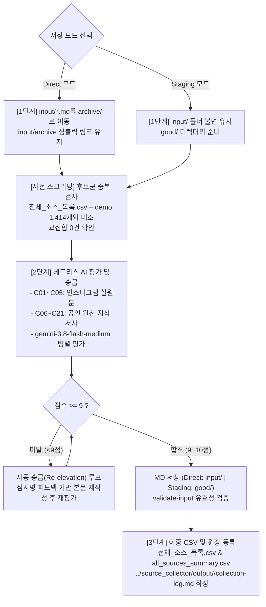

# 소스 수집 가이드 (Source Collection Guide)

최종 갱신일: 2026-11-09 · 기준 시간대: Asia/Seoul (한국 시간)

이 문서는 **오디오 숏폼 대본 제작을 위한 고품질 원천 소스(Source)를 확보하고, 품질을 검증하여 시스템에 등록하는 표준 운영 절차(SOP)**다.
에이전트는 본 가이드의 절차를 그대로 수행함으로써, 기존 수집본과의 중복 없이 고품질 소스를 수집·평가하고 시스템에 안전하게 등록할 수 있다.

---

## 1. 핵심 원칙 및 필수 요구사항

1. **저장 타깃 모드 (Direct vs Staging)**:
   - **Direct 모드 (`input/`)**: 대본 생성 파이프라인에 즉시 투입할 때 사용한다. 작업 시작 전 `input/`에 남아있는 기존 `.md` 파일은 모두 `archive/` 폴더로 안전하게 이동하여 보관한다.
   - **Staging 모드 (`good/`)**: 현재 파이프라인에서 실행 중인 `input/` 폴더를 건드리지 않고, 별도의 대규모 검증/승인 풀을 구축할 때 사용한다. `input/` 폴더는 일체 변경하지 않고 `good/`에 저장한다.
2. **사전 중복 스크리닝 및 중복 전면 배제 (Zero Duplication)**:
   - [`전체_소스_목록.csv`](전체_소스_목록.csv) 및 [`all_sources_summary.csv`](all_sources_summary.csv), `archive/` 내 기존 소스, [`demo/컨텐츠 제작 관리.txt`](../../demo/컨텐츠%20제작%20관리.txt)에 이미 존재하는 1,400여 개 주제와 중복되는 소스는 절대 수집하지 않는다.
   - AI 평가 전, **후보 목록의 제목·키워드·URL 집합과 기존 등록 집합의 교집합(Intersection)이 0건임을 코드로 사전 검증(Pre-screening)**한 뒤 평가 단계로 진입한다.
3. **C01 ~ C05 (사람과 일상): 인스타그램 실원문 필수**:
   - [`demo/컨텐츠 제작 관리.txt`](../../demo/컨텐츠%20제작%20관리.txt)와 동일하게 **인스타그램 공개 게시글 실원문**을 수집한다.
   - 인스타그램에 바로 접근할 수 없는 경우 미러/아카이브 사이트나 웹 검색을 통해 원본 게시글 URL(`https://www.instagram.com/p/...`)과 작성자 계정명을 반드시 확인한다.
   - **원본 URL을 확인할 수 없거나 중복된 소스는 절대 수집하지 않는다.**
   - 단순 팁, 일 잘하는 법, 처세술, 일반 교훈 에세이는 전면 배제하고, 구체적인 등장인물, 상황, 대화(따옴표 2회 이상), 갈등, 아찔한 위기, 반전, 여운이 있는 **순수 1인칭 사연/썰** 형태여야 한다.
4. **C06 ~ C21 (생활·지식·문화·신앙): 공인 원천 준수**:
   - [`docs/원천목록.csv`](../../docs/원천목록.csv)에 수록된 신뢰할 수 있는 공인 출처(대한민국 정책브리핑 `korea.kr`, 식품의약품안전처, 질병관리청, 한국어 위키백과, NASA, CDC, NPS, The Met, World English Bible, World Athletics 등)를 바탕으로 수집한다.
   - 구체적인 연도, 실명, 수치 데이터(%, 단위), 과학·역사적 작동 메커니즘과 일상 적용점을 갖추어야 한다.
5. **오디오 숏폼 적정 분량 (Text Length Standard)**:
   - **권장 본문 분량: 공백 포함 650자 ~ 950자** (60초 ~ 90초 낭독 속도에 최적화)
   - 허용 범위: 최소 500자 이상, 최대 1,200자 이하 (너무 짧으면 분량 부족, 너무 길면 청취 몰입도 저하로 감점).
6. **독립 헤드리스 AI 퀄리티 평가 (LLM-as-a-Judge, 9점 컷오프)**:
   - 컨텍스트 오염을 방지하기 위해 일회용 헤드리스 CLI 세션(`agy --model gemini-3.8-flash-medium --dangerously-skip-permissions -p "..."`)으로 평가한다.
   - [`demo/컨텐츠 제작 관리.txt`](../../demo/컨텐츠%20제작%20관리.txt)의 골드 스탠다드 소스(사연형: `S01`, `S05` / 지식형: `H01`, `I02`, `M04`) 대비 10점 만점으로 평가한다.
   - **9점 미만(8점 이하)은 즉시 탈락(Drop) 처리하고, 심사평 결함을 피드백으로 반영하는 자동 승급(Re-elevation) 루프를 통해 9점 이상(SCORE >= 9)만 최종 채택한다.**
7. **이중 마스터 원장 실시간 동기화**:
   - 채택된 모든 소스는 [`전체_소스_목록.csv`](전체_소스_목록.csv)와 [`all_sources_summary.csv`](all_sources_summary.csv)에 15개 정규 컬럼(UTF-8 with BOM)으로 동시에 기록한다.

---

## 2. 작업 수명주기 (3단계 프로세스)



### [1단계] 모드 선택 및 작업 디렉터리 준비
1. **Direct 모드 (`input/`)**:
   - `input/` 디렉터리 내에 남아있는 이전 소스(`.md`)들을 `archive/`로 이동한다:
     ```bash
     mkdir -p archive
     mv input/*.md archive/ 2>/dev/null || true
     ln -sfn ../archive input/archive
     ```
2. **Staging 모드 (`good/`)**:
   - `input/` 폴더는 일체 변경하지 않고 그대로 유지한다.
   - `good/` 디렉터리를 생성하여 작업 대상으로 사용한다:
     ```bash
     mkdir -p good
     ```

### [2단계] 소스 수집, 사전 스크리닝 및 헤드리스 AI 평가
1. **요청 시각 기반 ID 발급**:
   - 형식: `YYMMDD-HHMM-Cxx-NN` (예: `261109-1606-C01-01`)
   - 날짜와 시간은 사용자의 요청을 수신한 한국 시간(KST) 기준이다.
2. **사전 중복 스크리닝 (Pre-screening Automated Verification)**:
   - 평가 호출 전, 후보 목록의 제목과 URL이 기존 등록 건과 겹치지 않는지 파이썬 스크립트로 자동 검사한다:
     * `전체_소스_목록.csv` 및 `all_sources_summary.csv`의 `주제_제목` 집합
     * `demo/컨텐츠 제작 관리.txt` 내 1,414개 기존 주제 집합
     * C01~C05 인스타그램 URL 고유성 집합
   - 교집합(Overlap)이 발견되면 즉시 다른 소재로 교체하여 **중복 0건**을 확정한 뒤 평가 세션을 가동한다.
3. **헤드리스 세션 AI 평가 및 동시성 제어**:
   - 모델: `gemini-3.8-flash-medium`
   - **권장 병렬 워커 수**: `max_workers = 5 ~ 8` (시스템 락 및 서브프로세스 경합 방지)
   - **권장 타임아웃**: `timeout = 70s ~ 90s` (순간 지연 방어)
   - 필수 플래그: `--dangerously-skip-permissions`
4. **9점 미만 소스 자동 승급 (Re-elevation Loop)**:
   - 첫 평가에서 `SCORE < 9`를 받은 경우, 평가 사유(`REASON`)를 주입한 [자동 승급 프롬프트](#43-9점-미만-탈락-소스-자동-승급re-elevation-프롬프트-템플릿)로 본문을 즉시 리라이팅하고 재평가한다.
   - **반드시 SCORE >= 9를 획득한 소스만 채택**한다.
5. **파일 저장 및 유효성 검증**:
   - 저장 위치:
     * Direct 모드: `input/<source_id>.md` 및 `../source_collector/output/<batch_id>/<source_id>.md`
     * Staging 모드: `good/<source_id>.md` 및 `../source_collector/output/<batch_id>/<source_id>.md`
   - **유효성 검증 시 주의**: 반드시 프로젝트 루트(`/path/to/hyundai_pleos_app/ai/script_agent`)에서 실행해야 `config.toml`을 정상 참조한다.
     ```bash
     cd /path/to/hyundai_pleos_app/ai/script_agent
     .venv/bin/script-agent validate-input good/<source_id>.md
     ```

### [3단계] 이중 마스터 원장 등록 및 수집 일지 기록
1. 신규 채택된 소스들을 [`전체_소스_목록.csv`](전체_소스_목록.csv) 및 [`all_sources_summary.csv`](all_sources_summary.csv)에 동시에 추가(Append)한다.
2. 엑셀 호환성을 위해 `UTF-8 with BOM`(`utf-8-sig`) 인코딩을 엄수한다.
3. `../source_collector/output/<YYMMDD-HHMM>/collection-log.md`에 채택 현황, 라이선스, URL, 본문 SHA-256 해시를 기록한다.

---

## 3. 카테고리 분류 및 원천 매핑 기준

| 코드 | 카테고리명 | 유형 | 주요 공인 출처 (`원천목록.csv` 매핑) | 표준 라이선스 |
|:---:|:---|:---:|:---|:---|
| **C01** | 일·직장 | 창작·각색형 | 인스타그램 실원문 (`SRC-021`), 고용노동부 (`SRC-064`) | 인스타그램 공개 게시글 (창작·각색형) |
| **C02** | 연애·결혼 | 창작·각색형 | 인스타그램 실원문 (`SRC-021`), 통계청 자료 (`SRC-031`) | 인스타그램 공개 게시글 (창작·각색형) |
| **C03** | 가족·육아 | 창작·각색형 | 인스타그램 실원문 (`SRC-021`), 한국민속대백과사전 (`SRC-074`) | 인스타그램 공개 게시글 (창작·각색형) |
| **C04** | 친구·인간관계 | 창작·각색형 | 인스타그램 실원문 (`SRC-021`), 공유마당 (`SRC-047`) | 인스타그램 공개 게시글 (창작·각색형) |
| **C05** | 마음·습관·성장 | 창작·각색형 | 인스타그램 실원문 (`SRC-021`), 위키인용집 (`SRC-056`) | 인스타그램 공개 게시글 (창작·각색형) |
| **C06** | 자취·살림·생활팁 | 사실해설형 | 대한민국 정책브리핑 (`SRC-016`), 위키백과 (`SRC-055`) | 공공누리 제1유형 / CC BY-SA 4.0 |
| **C07** | 음식·맛집·식문화 | 사실해설형 | 한국어 위키백과 (`SRC-055`), 농식품 공공데이터 | CC BY-SA 4.0 / 공공누리 |
| **C08** | 돈·소비·생활경제 | 사실해설형 | 기재부·통계청 (`SRC-016`/`SRC-031`), 위키백과 (`SRC-055`) | 공공누리 제1유형 / CC BY-SA 4.0 |
| **C09** | 건강·운동·생활리듬 | 사실해설형 | U.S. CDC (`SRC-001`), MedlinePlus (`SRC-004`), 질병관리청 | U.S. Gov Public Domain / 공공누리 |
| **C10** | 반려동물·자연 | 사실해설형 | U.S. NPS (`SRC-032`), Smithsonian (`SRC-009`), 위키백과 | U.S. Gov Public Domain / CC0 |
| **C11** | 여행·지역·문화 | 사실해설형 | 한국관광공사, U.S. NPS (`SRC-032`), 위키백과 (`SRC-055`) | 공공누리 제1유형 / CC BY-SA 4.0 |
| **C12** | 패션·뷰티·자기표현 | 사실해설형 | 식약처 (`SRC-076`), The Met (`SRC-027`), 위키백과 (`SRC-055`) | 공공누리 제1유형 / CC0 / CC BY-SA |
| **C13** | 과학·기술·AI | 사실해설형 | NASA (`SRC-005`), arXiv (`SRC-043`), 위키백과 (`SRC-055`) | U.S. Gov Public Domain / CC BY-SA |
| **C14** | 역사·인물 | 사실해설형 | 국사편찬위원회, 국립중앙박물관 (`SRC-030`), 위키백과 | 공공누리 제1유형 / CC BY-SA 4.0 |
| **C15** | 언어·독서·인문 | 사실해설형 | 국립국어원 (`SRC-050`), 위키문헌 (`SRC-018`), 위키백과 | 공공누리 / CC BY-SA 4.0 |
| **C16** | 뉴스·사회·시사 | 사실해설형 | 대한민국 정책브리핑 (`SRC-016`), World Bank (`SRC-014`) | 공공누리 제1유형 |
| **C17** | 사건·미스터리·추리 | 사실해설형 | 한국어 위키백과 (`SRC-055`), 세계 범죄·사건사 | CC BY-SA 4.0 |
| **C18** | 음악·영화·예술 | 사실해설형 | The Met (`SRC-027`), 국립중앙박물관 (`SRC-030`), 위키백과 | CC0 1.0 Universal / 공공누리 제1유형 |
| **C19** | 스포츠·게임·취미 | 사실해설형 | World Athletics (`SRC-070`), Olympedia (`SRC-071`), 위키백과 | 사실 인용 / CC BY-SA 4.0 |
| **C20** | 자동차·교통·이동 | 사실해설형 | 도로교통공단, 교통안전공단, 정책브리핑 (`SRC-016`) | 공공누리 제1유형 / CC BY-SA 4.0 |
| **C21** | 성경·말씀·신앙 | 해석·감상형 | World English Bible (`SRC-015`), 위키백과 (`SRC-055`) | Public Domain / CC BY-SA 4.0 |

---

## 4. 헤드리스 AI 퀄리티 평가 상세 지침 (LLM-as-a-Judge)

모든 후보 소스는 모델 `gemini-3.8-flash-medium`을 사용하는 독립 헤드리스 명령으로 평가한다.

### 4.1 평가 프롬프트 구조
```bash
agy --model gemini-3.8-flash-medium --dangerously-skip-permissions -p "$(cat << 'EOF'
당신은 오디오 숏폼 대본용 소스의 퀄리티를 엄격히 평가하는 전문 에디터입니다.
도구를 일체 사용하지 말고 오직 평가 결과만 한 줄로 출력하세요.

[기준 콘텐츠 (Gold Standard)]
- 사연형(C01~C05): S01(100일 여행 조수석 실수 썰), S05(권고사직 뒤 새벽에 온 문자 썰)
- 지식/인사이트형(C06~C21): H01(신장 투석 이야기), I02(제임스 랜디의 초능력 검증), M04(로저 배니스터 4분 마일)

[평가 대상 소스]
카테고리: {category_code} ({category_name})
제목: {title}
출처 URL: {source_url}
내용:
{body_text}

[평가 기준]
1. 사연형(C01~C05): 구체적 인물, 생생한 대화(큰따옴표 2회 이상), 아찔한 위기/갈등, 뜻밖의 반전과 여운이 있는 1인칭 경험담/썰인가? (단순 팁·교훈문은 5점 이하)
2. 지식형(C06~C21): 신뢰할 수 있는 출처, 구체적 연도·인명·수치 데이터, 핵심 메커니즘, 청취자의 호기심을 자극하고 일상에 닿는 명쾌한 통찰이 살아있는가?
3. 점수는 10점 만점 정수로 평가하며, 기준 콘텐츠 대비 손색없는 탁월한 소스만 9점 이상 부여하세요. (9점 미만 탈락)

반드시 아래 형식으로만 한 줄로 응답하세요:
SCORE: <정수 1~10> | REASON: <한줄 심사평>
EOF
)"
```

### 4.2 동시성 및 안정성 설정 (Concurrency Guidelines)
대량 수집 시 파이썬 `concurrent.futures.ThreadPoolExecutor`를 사용할 때 아래 설정을 권장한다:
- **`max_workers = 6`** (5~8 범위 권장): 과도한 프로세스 포크로 인한 CLI 서브프로세스 데드락 및 리소스 고갈 방지.
- **`timeout = 80s`** (70~90초 권장): 고품질 평가 생성 시 순간 지연으로 인한 오탐(0점 탈락) 방지.
- 필수 옵션: `--dangerously-skip-permissions` 플래그를 주입하여 대화형 권한 확인 프롬프트 대기로 인한 블로킹 방지.

### 4.3 9점 미만 탈락 소스 자동 승급(Re-elevation) 프롬프트 템플릿
첫 심사에서 9점 미만을 받은 경우, 즉시 심사평(`{rejection_reason}`)을 파라미터로 주입하여 본문을 재작성한다:

```bash
agy --model gemini-3.8-flash-medium --dangerously-skip-permissions -p "$(cat << 'EOF'
당신은 오디오 숏폼 대본용 최고급 소스 작가입니다.
아래 소스는 전문 평가에서 9점 미만을 받았습니다 (탈락 사유: {rejection_reason}).
이 소스를 기준 콘텐츠(S01, S05, H01, I02, M04)처럼 10점 만점 중 9~10점을 받을 수 있도록 완벽하게 다시 작성해 주세요.

규칙:
1. 카테고리: {category_code} ({category_name}), 제목: {title}
2. 방향성:
   - 사연형(C01~C05): 1인칭 주인공 시점, 생생한 구어체 대화(따옴표 2회 이상), 아찔한 위기 순간과 감정선, 허를 찌르는 반전과 진한 여운을 반드시 담을 것.
   - 지식형(C06~C21): 구체적인 연도, 인물, 통계 수치(%, 단위), 핵심 작동 메커니즘을 밝히고, 시작부터 호기심을 자극하는 질문과 일상 적용점을 담은 명쾌한 지적 서사로 완성할 것.
3. 분량: 공백 포함 650자 ~ 950자 내외 한국어 산문.
4. 다른 설명이나 인사말 없이 오직 보강된 본문 텍스트만 출력할 것.

원문:
{original_body_text}
EOF
)"
```
재작성된 본문은 동일한 심사 세션으로 재평가하여 **SCORE >= 9를 확인한 후 최종 채택**한다.

---

## 5. 소스 Markdown 파일 형식 및 규격

한 소스는 하나의 UTF-8 Markdown 파일로 저장하며, 파일명은 `<source_id>.md`다.

### 5.1 YAML Front Matter 및 본문 템플릿
```markdown
---
source_id: '261109-1606-C01-01'
source_url: 'https://www.instagram.com/p/DXbLQeflwtn/'
source_kind: original
author: '@jeokjul'
category: C01
production_type: 창작·각색형
target_sec: 90
info_as_of: '2026-11-09'
collected_at: '2026-11-09T16:06:52+09:00'
edition: null
license:
  kind: 인스타그램 공개 게시글 (창작·각색형)
  version: null
  commercial: true
  modify: true
  share_alike: false
  url: null
  evidence: 인스타그램 공개 게시글 원문 및 이용조건 확인; 숏폼 오디오 사연 각색 목적 재구성
attribution: '원문: 인스타그램 @jeokjul / https://www.instagram.com/p/DXbLQeflwtn/ / 창작·각색형 사연 대본 구성'
fixture: false
notes: |
  요청 수신 시각: 2026-11-09T16:06:52+09:00
  요청 내용·수집 조건: C01 일·직장 세부 카테고리 25건 정본 수집 및 헤드리스 AI 퀄리티 평가(9점 이상 확보)
  원문 제목: 첫 출근날 사수 대신 부사장님 컴퓨터 선 뽑아버린 신입의 최후
  매체·발행 기관: 인스타그램 @jeokjul
  자료 성격: 사연/썰 경험담
  원문 언어: 한국어
  게시일: 2026-11-09
  수정일: 해당 없음
  선정 이유: C01 카테고리 부합 및 고품질 오디오 숏폼 대본 적합성 확보
  추가 카테고리: 없음
  발견 URL: https://www.instagram.com/p/DXbLQeflwtn/
  실제 추출 URL·최종 도착 URL: https://www.instagram.com/p/DXbLQeflwtn/
  원출처 대조: 원본 웹페이지 대조 완료
  전문 범위: 본문 전문 수록
  포함·제외 내역: 메뉴·광고 제외, 본문 완비
  전문 확인: 완료
  추출 방법: 텍스트 추출 및 정형화
  OCR 대상·대조 기록: 해당 없음
  OCR 교정 기록: 해당 없음
  미판독·누락 구간: 없음
  인용된 근거 자료: 없음
  발언 주체·조건 관련 유의점: 원문 맥락 유지
  헤드리스 품질 평가 모델: gemini-3.8-flash-medium (headless agy -p)
  품질 평가 기준: demo/컨텐츠 제작 관리.txt 기준 (10점 만점 9점 이상 합격)
  품질 평가 결과: SCORE: 9 | REASON: 첫 출근의 극심한 긴장감과 아찔한 실수, 생생한 대화와 유쾌한 반전 결말까지 오디오 숏폼에 최적화된 완벽한 서사 구성을 갖춤.
  본문 SHA-256: da13d01918a56d59...
---

# 첫 출근날 사수 대신 부사장님 컴퓨터 선 뽑아버린 신입의 최후

출근 첫날, 정장 깃을 몇 번이나 매만지며 들어선 대기업 마케팅팀은 숨소리조차 조심스러울 만큼 고요했습니다.
...
```

### 5.2 유효성 검증 명령 및 작업 디렉터리 주의사항
작성된 모든 파일은 프로젝트 가상환경의 검증 CLI를 통과해야 한다.
`config.toml`을 정상적으로 읽어오기 위해 **반드시 프로젝트 루트에서 실행**해야 한다:
```bash
cd /path/to/hyundai_pleos_app/ai/script_agent
.venv/bin/script-agent validate-input <파일경로>/<source_id>.md
```
- 정상 검증 시 JSON 출력 예시:
  ```json
  {"valid": true, "characters": 910, "production_type": "창작·각색형", "sha256": "...", ...}
  ```
- 결과가 `{"valid": true, ...}`이어야 최종 인계 가능하다.

---

## 6. 마스터 CSV 스키마 및 이중 원장 관리

채택된 소스는 [`전체_소스_목록.csv`](전체_소스_목록.csv) 및 [`all_sources_summary.csv`](all_sources_summary.csv) 두 파일에 동시에 기록한다.

### 6.1 컬럼 정의 (15개 정규 컬럼, 소스ID 맨 앞, 구분 제외)
1. **`소스ID`**: 소스 식별자 (`YYMMDD-HHMM-Cxx-NN`)
2. **`카테고리_코드`**: 세부 카테고리 (`C01` ~ `C21`)
3. **`카테고리명`**: 카테고리 한국어 명칭 (예: `일·직장`, `과학·기술·AI`)
4. **`주제_제목`**: 소스 제목
5. **`원천목록_ID`**: `docs/원천목록.csv`의 ID (예: `SRC-016`, `SRC-055`, `SRC-021` 등)
6. **`원천_명칭`**: 공인 출처 명칭 (예: `대한민국 정책브리핑`, `인스타그램 (창작·각색 실원문)`)
7. **`작성자_발행처`**: 저자 또는 발행 기관 (예: `@jeokjul`, `한국어 위키백과`, `NASA`)
8. **`원본_URL`**: 확인된 원본 URL
9. **`간략_주제_요약`**: 본문의 첫 1~2문장 핵심 요약 (100~150자 내외)
10. **`제작유형`**: `창작·각색형`, `사실해설형`, `해석·감상형`
11. **`라이선스`**: 라이선스 종류 (예: `CC BY-SA 4.0`, `공공누리 제1유형`, `Public Domain`)
12. **`본문_글자수`**: Markdown 본문 글자 수 (공백 포함)
13. **`수집일시`**: 수집 일시 (ISO-8601, KST)
14. **`AI_평가점수`**: gemini-3.8-flash-medium 평가 점수 (9 또는 10)
15. **`AI_심사평`**: 평가 심사평 요약

### 6.2 인코딩 규칙
- 두 CSV 파일 모두 Excel 직접 열람 시 한글 깨짐을 방지하기 위해 **UTF-8 with BOM (`utf-8-sig`)** 인코딩으로 저장한다.

---

## 7. 인계 전 체크리스트

- [ ] 작업 목적에 맞춰 **저장 타깃 모드**(`input/` Direct 모드 vs `good/` Staging 모드)를 올바르게 적용했는가?
- [ ] 평가 전, **사전 스크리닝(Pre-screening)**을 통해 기존 `전체_소스_목록.csv` 및 `demo/컨텐츠 제작 관리.txt`(1,414개)와의 제목·URL 중복 0건을 확인했는가?
- [ ] C01~C05의 경우 실제 인스타그램 게시글 URL(`https://www.instagram.com/p/...`)과 작성자를 검증했는가?
- [ ] C06~C21의 경우 `docs/원천목록.csv`에 등재된 공인 출처 및 데이터/메커니즘을 준수했는가?
- [ ] 본문 분량이 오디오 숏폼 적정 분량(공백 포함 650자 ~ 950자 내외)을 충족하는가?
- [ ] 전 소스에 대해 독립 헤드리스 세션(`gemini-3.8-flash-medium`) 평가를 거쳐 전원 **9점 이상(SCORE >= 9)**을 획득했는가?
- [ ] 프로젝트 루트에서 `.venv/bin/script-agent validate-input` 명령을 실행하여 모든 파일이 `{"valid": true}`를 반환하는가?
- [ ] `전체_소스_목록.csv`와 `all_sources_summary.csv` 두 파일에 15개 컬럼(UTF-8-SIG)으로 누락 없이 동기화되었는가?
- [ ] `../source_collector/output/<batch_id>/collection-log.md` 수집 원장에 채택 목록과 SHA-256 해시가 온전하게 작성되었는가?
