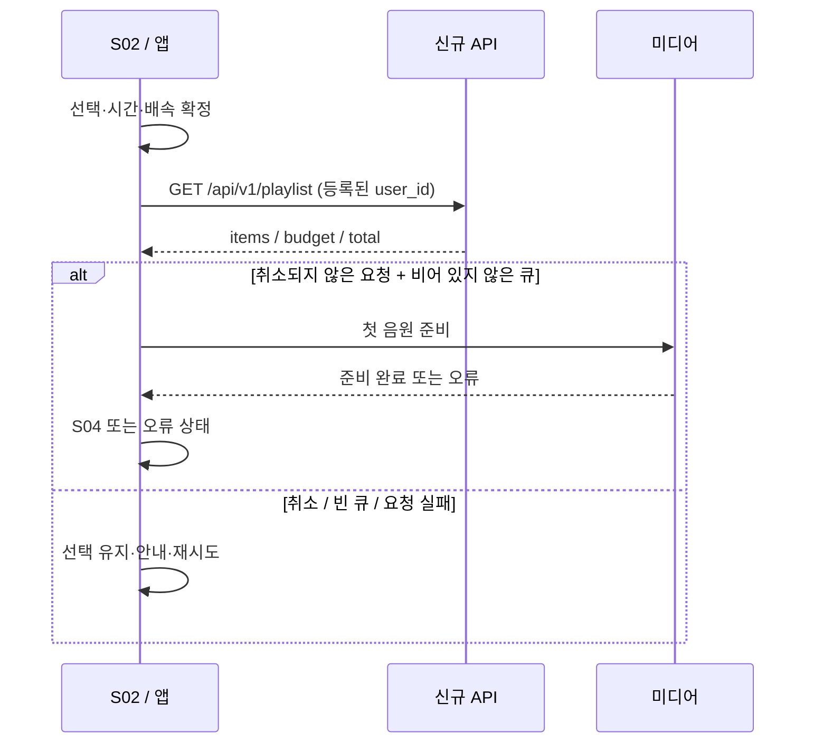

> 2026-11-05 latest: GET /api/v1/playlist is connected to the recommendation core (default recommend; optional pick/legacy). Blank interests read saved preferences. Existing listening reactions are connected; selection history and skip timing are not. Canonical topics come from PR #10. See [current API contract](../../server/teum/playlist/README.md). Earlier implementation status below is historical.

> S1-11·S1-12 시간·광고·주제 비중의 최신 계약: [추천·편성 구현](S1-11_S1-12_추천_편성_구현.md). 기본 광고 10–15%, 골라 듣기 대분류별 이야기 시간 최소 10%, 항목별 playback_rate와 정책 응답을 확인한다.

# 온에어 · API 연동 가이드

기준일: 2026-11-04

[UI 기능 명세](ui-functional-spec.md)의 화면을 서버·차량 SDK와 연결하기 위한 문서다. **신규 앱은 PR #2의 모듈형 서버 + PR #4의 사용자·반응 API를 합친 규격**을 기준으로 한다. 기존 시범 서버는 호환·이행 참고로 구분한다.

## 1. 근거와 적용 상태

### 관련 PR

| PR | 무엇을 바꾸는가 | 확인한 상태·문서 적용 |
| --- | --- | --- |
| #2 · 서버 모듈 분리 | `server_trial/`을 `server/teum/`으로 이동. 기능별 APIRouter·공용 설정·lifespan·`/api/v1` 도입 | main 병합 완료. 신규 서버의 구조·경로 기준 |
| #4 · 사용자·반응 API | 기기 토큰, 이벤트 15종·배치·중복 제거, 청취 상태 재계산, 저장·관심사 | 열림·미병합. 신규 앱의 연동 목표 규격. PR 설명상 미배포 |
| #5 · 콘텐츠 제작 파이프라인 | 대본 → TTS 작업·결과 수집 → 사람 검수 → 카탈로그 게시 | 열림·미병합. 콘텐츠 공급 경로. 인증·이벤트 규격의 근거는 #4 사용 |
| #3 · TTS 학습·평가 | 음성 데이터 전처리·학습 수정·평가 도구 | 열림·미병합. 오프라인 음원 제작이며 앱의 실시간 TTS API가 아님 |
| #1 · 폴더 구조 | 공통 폴더 골격 | 서버 규격 변경이 아님. `services/api/` 폴더가 있다는 이유로 실제 API 위치로 안내하지 않음 |

‘신규 서버’는 별도 마이크로서비스 여러 개가 아니라 **하나의 FastAPI 앱 안에 기능별 모듈을 둔 서버**다. PR #2만 반영된 main은 새 경로를 사용하지만 청취 API는 이전 8종 형식이다. 이 문서의 신규 이벤트·토큰 예시는 PR #4가 포함된 실행 환경을 전제로 하며, main만 실행한 서버에 그대로 보내면 안 된다.

### 코드·설계·협의 근거

| 자료 | 읽을 부분 |
| --- | --- |
| 신규 서버 README · PR #2 스냅샷 | 구조·실행·설정. 하단 listening 제안은 #4에서 구현된 범위와 구분 |
| listening 규격 v0.21 · PR #4 스냅샷 | 이벤트·토큰·배치·청취 상태·버전 정책. 제공된 API 설계안 v0.21의 저장소 사본 |
| listening router · schemas | 실제 HTTP 입력·응답·검증 범위 |
| state · store | 구간 집계·seq 재계산·DB 저장 |
| playlist router · scheduler | user_id 유지·관심사 쿼리·시간 편성 |
| 구 시범 서버 코드 | 삭제 전 고정 커밋. 신규 계약과 비교할 때만 사용 |
| Slack · 10/31 앱 연동 협의 | 이벤트 15종·10초 주기·배치 500개·식별자 영속화 방향 |
| Slack · 11/4 1차 피드백 | #2 병합 확인, #4 입력·세션·광고 검증, #5 관심사·음원 전달 확인, #6 문서 갱신 요청 |
| [Figma 00 · 화면별 API](https://www.figma.com/design/9It28NuJJzcmZm9pnc090V?node-id=14-4548) · [상태·복원](https://www.figma.com/design/9It28NuJJzcmZm9pnc090V?node-id=40-4935) | 화면과 앱 상태의 연결 |

PR 상태와 구현 확인은 위 기준일의 스냅샷이다. PR #4/#5의 리뷰 중 수정은 재확인해야 한다. 다른 PR이 보고한 테스트 통과는 이 문서 작성 중 새로 실행한 결과가 아니다.

### 주소를 해석하는 방법

| 환경 | 코드·주소 기준 | 배포 확인 |
| --- | --- | --- |
| 기존 시범 | `server_trial/`, `/contents`, `/playlist`, `/events`, `/history` | 이전 시범 운용 주소(개인 도메인)는 폐기. 현재 주소는 `https://api.onaircar.com/api/v1` |
| 신규 앱 대상 | `server/teum/`, `https://<확정된 호스트>/api/v1/...` | 공개 호스트·TLS·배포 시점 미확정. `/api/v1`은 확인된 경로이며 호스트는 추정하지 않음 |
| 신규 로컬 실행 예 | `http://localhost:8765/api/v1/docs` | 개발용 실행 예. 차량 앱의 localhost는 개발 PC가 아님 |

11/3 Slack에는 배포용 3090 서버 사용권한 공유가 논의돼 있다. 이는 공개 API 주소나 배포 완료 증거가 아니다. TTS 투표 주소도 앱 API 주소로 사용하지 않는다.

앱 설정에서는 호스트를 `SERVER_ORIGIN`, JSON API 경로를 `/api/v1`로 분리한다. `audio_uri`가 `/api/v1/audio/...`이면 **호스트 기준으로** 해석한다. 이미 접두어가 있는 URI에 `/api/v1`을 다시 붙이지 않는다.

## 2. 화면과 API 대응

아래 경로는 신규 기준이며 #4 포함 환경이 필요하다.

| 화면·상황 | 요청·데이터 | 앱 처리·남은 경계 |
| --- | --- | --- |
| 최초 설치 | `POST /api/v1/devices` | install_id 생성, user_id·token 비공개 영속 저장 |
| S01 추천 / S02 골라 듣기 | `GET /api/v1/playlist` | 등록 응답 user_id·minutes·interests·speed. 연속 추천은 추가 계약 |
| S02 관심사 보관 | `PUT/GET /api/v1/me/interests` | Bearer 토큰. A–E → 실제 category 매핑 필요 |
| S04 제목·음원 | `/api/v1/contents/{content_id}`, `audio_uri` | 원본 미디어 길이와 편성상 길이 구분 |
| S04 재생·정지·재개·다음 | `/api/v1/events` 또는 `/events/batch` | play/pause/resume/skip/position, UUID·seq·시각·배속 포함 |
| S04 좋아요 | `like/unlike`, `/api/v1/history`의 `liked` | 위치·last_ts와 독립 |
| S04 보관 / S06 목록 | `save/unsave`, `/api/v1/history`의 `saved` | saved=true 필터 후 콘텐츠 정보 결합. 별도 저장 전용 API 불필요 |
| S04 다음 목록 | 편성 `items`·앱 queue | 다음 최대 5개, 접힘 2개. 큐 보충·유한 큐 종료는 앱 정책 |
| S05 광고 | kind=ad·audio_uri·`ad_start/ad_complete/ad_error` | 일반 콘텐츠 청취 집계와 분리, 이전/다음 비활성 |
| S08 설정 | 동의·삭제 대응 API 없음 | 관심사 저장 API를 동의·기록 삭제 API로 대체하지 않음 |
| 앱 복원 | `/api/v1/history` + 로컬 상태 | 마지막 큐·배속·user_paused는 앱이 보관 |
| 내비·주행 제한 | 차량 SDK | REST 서버와 별도 연결·실차 검증 |

## 3. 신규 API 계약

### 3.1 기기 등록과 인증

```http
POST /api/v1/devices
Content-Type: application/json
```

```json
{"install_id":"random-install-id","app_version":"0.1.0","platform":"pleos-connect"}
```

201 응답 예시:

```json
{"user_id":"u_example","token":"t_example"}
```

앱은 최초 실행 때 사람·차량 식별정보가 아닌 무작위 install_id를 만든다. 같은 install_id로 재등록해도 **매번 새 user_id·token**을 받는다. 보유한 토큰은 만료되지 않으며, 정상 실행마다 재등록하지 않는다. 분실·재설치 시 새 사용자가 되고 이전 기록은 자동 연결되지 않는다.

| API 그룹 | #4의 실제 사용자 전달 방식 |
| --- | --- |
| `/events`, `/events/batch`, `/history`, `/me/interests` | `Authorization: Bearer <token>`. user_id는 서버가 토큰에서 결정 |
| `/playlist`, 이력 범위 `/contents/search` | 등록 응답의 user_id를 기존 쿼리 자리에 전달 |
| `/intent` | 등록 응답의 user_id를 기존 본문 자리에 전달 |
| `/contents`·음원 | 현재 해당 라우터에는 토큰 의존성이 없음. 공개 콘텐츠 조건 적용 |

모든 API가 토큰 전용으로 전환됐다고 문서화하지 않는다. playlist/search/intent의 토큰 전환은 각 모듈이 `CurrentUserDep`를 사용하도록 바꾼 뒤의 단계다. 이전 user_id 본문을 새 이벤트에 추가해도 인증 대체가 되지 않는다. 모르는 필드는 무시되며 식별자 없는 구 이벤트 형식은 호환되지 않는다.

### 3.2 콘텐츠·검색·음원

| 요청 | 입력·응답 |
| --- | --- |
| `GET /api/v1/contents` | category 선택·정확 일치, max_duration 선택·원본 초/0 초과. `{channel,count,items}`·story만 반환 |
| `GET /api/v1/contents/{content_id}` | 공개 필드 + script. 비공개·미존재 404 |
| `GET /api/v1/contents/search` | q 필수·길이 1 이상, k=1–20/기본 5, mode=bm25/dense/hybrid, scope=catalog/listening_history |
| 이력 범위 검색 | user_id 필수. 토큰만 보내면 대체되지 않음 |
| `GET /api/v1/audio/{name}`, `/api/v1/gen/{name}`, `/api/v1/ads/{name}` | 응답 audio_uri를 그대로 호스트에 결합. 공개 URI만 제공, media type은 audio/mpeg |
| `POST /api/v1/intent` | `{text,user_id}` → input/parsed/action/candidates/message. STT 스트림 API가 아님 |

콘텐츠 공개 필드는 `content_id, kind, title, category, tags, duration_sec, audio_uri, license, attribution, source_url`이다. 출처는 null일 수 있다. 페이지네이션·카탈로그 version은 #2/#4 기준으로 없다. 설계안의 content_version 지원과 카탈로그 version 배포를 구분한다.

intent의 `action.type=play`에 있는 `start_at_sec`는 **콘텐츠 내부 시작 위치**다. skip/pause/like 액션은 앱이 실행·기록해야 하며 intent 요청 자체로 미디어 제어·이벤트 저장이 끝나지 않는다. action=null·모호한 후보도 처리한다.

### 3.3 시간 편성

```http
GET /api/v1/playlist?user_id=u_example&minutes=30&interests=insight,life&speed=1.0
```

| 필드 | 현재 계약 |
| --- | --- |
| user_id | 필수. `/devices`에서 받은 값 사용 |
| minutes | 필수 실수, 0 초과·600 이하. UI는 15/30/60 또는 유효 ETA |
| interests | 기본 빈 문자열. 쉼표 분리 category 우선순위. 공백 정리·enum 검증 없음 |
| speed | 기본 1.0, 0 초과·3 이하. UI는 0.8/1.0/1.2/1.5 |

`insight,life`는 기존 category 예시이며 S02의 A/B 매핑 확정값이 아니다. 응답 예시는 구조 설명용이며 실제 데이터 캡처가 아니다.

```json
{
  "items":[{"content_id":"story-example","kind":"story","title":"이야기 제목","category":"insight","duration_sec":60.0,"start_at_sec":0.0,"audio_uri":"/api/v1/audio/example.mp3","attribution":null,"license":null}],
  "total_sec":60.0,"budget_sec":1800.0,"leftover_sec":1740.0,
  "rule":"관심 분류 우선 → 안 들은 것 우선 → 관리 순서, 이야기 2편마다 광고"
}
```

`items[].duration_sec`는 **원본 길이 ÷ speed**, `start_at_sec`는 **편성 전체의 누적 시작 시간**이다. 후자를 콘텐츠 내부 seek 위치로 쓰지 않는다. 미디어 위치는 history/로컬 위치, 전체 길이는 콘텐츠 상세/미디어 메타데이터를 사용한다. total_sec·leftover_sec과 항목 길이는 소수 첫째 자리 반올림이다. 광고 항목에는 attribution·license가 없을 수 있다.

저장된 관심사 자동 적용은 아직 없다. #4는 `ListeningStore.interests(user_id)`를 제공하지만 playlist router는 쿼리만 읽는다. 쿼리가 비었을 때 저장값을 읽는 연결은 **편성 모듈의 미완료 작업**이다.

### 3.4 이벤트 15종과 필드

| type | 전송 시점 | 위치 |
| --- | --- | --- |
| play | 새 콘텐츠 재생 시작. 새 playback_id 생성 | 시작 위치 |
| position | 10초마다 + 탐색 직전/직후·배속 변경·정지/스킵/전환 직전 | 현재 위치 |
| pause | 사용자 정지·전화·시동 OFF 등 안내 외 포커스 상실. 안내 중 사용자 정지도 포함 | 현재 위치 |
| resume | 일시정지 뒤 실제 재개. 같은 playback_id 유지 | 현재 위치 |
| skip | 다음 콘텐츠로 넘김 | 넘긴 시점 |
| complete | 끝까지 재생되어 자동 전환 | 콘텐츠 길이 |
| duck_start | 내비 안내 시작. 안내 때문에 내부 정지한 것은 pause로 중복 전송하지 않음 | 현재 위치 |
| duck_end | 안내 종료. 실제 재개 여부와 무관하게 전송 | 현재 위치·Android는 되감은 위치 |
| like / unlike | 좋아요 / 취소 | 없음 |
| save / unsave | 보관 / 해제 | 없음 |
| ad_start / ad_complete / ad_error | 광고 시작 / 정상 종료 / 실패 | 0 / 광고 길이 / 실패 위치 |

기획의 play_start는 play, play_complete는 complete로 매핑한다. 광고는 ad_*로 기록하고 일반 콘텐츠 complete와 혼합 집계하지 않는다.

| 필드 | 앱이 보내는 값·규칙 |
| --- | --- |
| event_id | UUID 문자열. 재전송 때 같은 값, 새 이벤트는 새 값 |
| content_id | 공개 카탈로그 ID. 광고 이벤트도 요청에서는 이 필드에 광고 ID 사용 |
| playback_id | play마다 생성하는 UUID. 해당 재생의 이벤트에 유지. 재생 밖 반응은 비울 수 있음 |
| seq | 기기 안에서 단조 증가하는 정수. 재실행 후에도 이어짐 |
| type | 위 15종 |
| position_sec | 원본 미디어 초. like/unlike/save/unsave는 생략 |
| playback_rate | 위치가 실리는 콘텐츠 이벤트의 실제 속도. 기본 1.0 |
| content_version | 재생 음원의 버전. 기본 1. 카탈로그 version 제공 전에는 1 사용 |
| client_ts | 발생 시각 ISO 8601 문자열·시간대 필수 |

user_id·received_at은 서버가 결정한다. ad_*는 content_version/playback_rate를 보내지 않으며 저장 시에도 제외한다. 스키마가 모든 의미 규칙을 강제하는 것은 아니다. #4의 코드가 playback_id 형식·필수 위치·양수 배속·seq 단조 증가 등을 전부 검증한다고 가정하지 말고 앱에서 규격을 지킨다.

### 3.5 단건·배치 전송과 응답

```http
POST /api/v1/events
Authorization: Bearer <token>
Content-Type: application/json
```

```json
{
  "event_id":"6f1c2a3e-9b7d-4c1e-8a2f-0d5e4b3c2a10",
  "content_id":"story-example","content_version":1,
  "playback_id":"2b8e4f6a-1c3d-4e5f-9a7b-8c6d5e4f3a21",
  "seq":41,"type":"position","position_sec":38.2,"playback_rate":1.0,
  "client_ts":"2026-11-04T10:00:00+09:00"
}
```

200 응답은 `{"accepted":1,"duplicate":0}`이며 재전송 중복은 `{"accepted":0,"duplicate":1}`이다. 둘 다 큐에서 제거할 성공이다. 구 응답 `{"ok":true}`를 기대하지 않는다.

`POST /api/v1/events/batch`는 같은 토큰과 `{"events":[...이벤트...]}` 봉투로 최대 500개를 받는다. 항목별 스키마 위반·unknown_content를 분리한다. 예시:

```json
{
  "accepted":48,"duplicate":2,
  "rejected":[
    {"index":50,"event_id":"9aaf6791-6a5b-4605-96d1-a011a160b3ed","reason":"unknown_content"},
    {"index":51,"event_id":null,"reason":"invalid"}
  ]
}
```

index는 요청 배열의 위치다. 유효한 200 응답을 받은 배치의 accepted·duplicate·rejected는 모두 전송 큐에서 제거한다. 거절 원인은 진단용으로 남길 수 있으나 같은 잘못된 이벤트를 무한 재전송하지 않는다. 5xx·무응답은 event_id를 유지해 재전송한다.

**리뷰 대기:** 11/4 피드백은 잘못된 값 하나가 정상 배치까지 막지 않는지, 위치·세션 검증과 광고 분리를 확인하도록 요청했다. #4의 항목별 ValidationError 처리는 존재하지만 저장·재계산 예외까지 모든 입력이 격리된다고 보장하지 않는다. 이 부분은 수정·통합 시험 후 확정한다.

### 3.6 이력·저장·관심사

`GET /api/v1/history`는 Bearer 토큰으로 호출하며 user_id 쿼리를 요구하지 않는다.

```json
{
  "user_id":"u_example",
  "items":[{"content_id":"story-example","last_position_sec":38.2,"played_sec":36.9,"completed":false,"finished":false,"skipped":false,"liked":true,"saved":false,"last_ts":1793754000.0}]
}
```

| 필드 | 새 규칙 |
| --- | --- |
| played_sec | 유효 청취 구간 합집합 길이. 반복 구간 중복 제외 |
| completed | played_sec ≥ 길이×0.8 또는 이전 버전 묶음의 prev_completed |
| finished | 현재 playback_id의 끝 도달. complete 또는 마지막 위치가 끝 1초 이내 |
| last_position_sec / last_ts | 위치 이벤트의 마지막 seq 기준 위치 / client_ts를 epoch 초로 변환한 값 |
| liked / saved | like/unlike·save/unsave 중 마지막 seq의 상태. 위치·last_ts는 바꾸지 않음 |
| skipped | 현재 버전 묶음 안에서 skip 수신 여부 |

공개 철회 콘텐츠는 응답에서 빠진다. DB에 있는 버전 관리 필드 전체가 history 응답으로 노출되는 것은 아니다. 완청한 콘텐츠를 다시 듣다 멈추면 completed=true·finished=false일 수 있다. 늦은 이벤트 도착으로 **동일 버전 묶음의 재계산 결과가 정정될 수 있으므로**, completed를 무조건 영구 참으로 취급하지 않는다.

S06은 history에서 saved=true인 ID를 골라 공개 콘텐츠 메타데이터와 결합한다. 저장 전용 목록 API·정렬 시각·페이지네이션은 없다. 해제는 unsave로 기록하고 오류·오프라인 때 UI의 보류 상태와 재전송 큐를 관리한다.

`PUT /api/v1/me/interests`는 토큰과 `{"interests":["history","science","life"]}`를 보내 **전체 교체**한다. GET은 같은 값과 updated_at을 반환하며 미저장은 `{"interests":[],"updated_at":null}`이다. 공개 카탈로그의 category에 없는 값은 422다. A–E나 C01–C21을 검증 없이 보내면 안 된다.

## 4. 편성·추천 연결

공개 이야기 중 completed=true를 제외하고 관심 분류 우선 → 미청취 우선 → 관리 순서로 정렬한다. 배속 반영 길이가 예산에 들어가는 항목을 추가하고 이야기 2편마다 예산에 맞는 광고를 삽입한다. 이 알고리즘은 #2/#4에서 기본적으로 유지하며 completed를 만드는 의미만 새 청취 상태로 바뀐다.

`interests`는 **강제 필터가 아닌 우선순위**다. 선택 밖 분류를 허용할지 확정해야 한다. 편성은 콘텐츠 전체 길이를 사용하며 중간 청취 위치만큼 예산을 줄이지 않는다. minutes=0은 무제한 값이 아니며 422다.



목록 로딩 1.2초·내비 24분은 Figma 시연값이다. 실제 성공·실패로 연결하고, 듣기 실행 후 늦게 도착한 ETA나 취소된 요청의 응답으로 편성을 바꾸지 않는다.

추천 듣기의 연속 보충은 #4에서도 추가 계약이다. 세션·커서·대기 ID 제외가 없고 광고 카운터/순환 인덱스도 편성 호출마다 초기화된다. 단순 반복 호출로 무제한 추천·광고 정책을 보장하지 않는다. 다음 최대 5개만 실제 큐로 표시하며, 골라 듣기의 종료·연장·재편성·재생 중 시간 초과 정책은 확정이 필요하다.

## 5. 추가 계약이 필요한 기능

| 항목 | 신규 기준에서 구현된 것 | 남은 작업 |
| --- | --- | --- |
| 좋아요·보관 | unlike/save/unsave, history liked/saved | 앱 토글·실패/오프라인·S06 목록 연결. 새 저장 API부터 만들 필요 없음 |
| 관심사 | PUT/GET me/interests·저장소 조회 | A–E 매핑, 빈 편성 쿼리 때 저장값 적용 |
| 연속 추천 | 유한 시간 편성 | 세션·보충·중복·광고 카운터 |
| 카탈로그 버전 | 이벤트 content_version·state 버전 묶음 | catalog와 contents의 version 필드·교체 음원 처리 |
| 동의·기록 삭제 | 대응 API 없음 | 목적·항목·보관·철회·로컬/서버 삭제 범위 |
| 배포·인증 | 기기 토큰·listening 인증 | 호스트/TLS·토큰 저장 보강·제한·다른 라우터 토큰 전환 |
| 제작 콘텐츠 | #5의 검수·게시 파이프라인 | category 일치·음원 URI/파일·카탈로그 로딩·공개 철회 |

### 주제·콘텐츠 공급 경계

UI는 A 사람과 일상 / B 생활과 취향 / C 지식과 세상 / D 문화·취미·이동 / E 성경과 신앙이다. 내부 C01–C21을 참고하며 P01은 제외한다. 서버에는 funny/insight/emotional/motivation/science/history/economy/life 등의 기존 category가 있어 단순 이름 치환만으로 정확히 대응하지 않는다.

PR #5는 대본→TTS→검수→카탈로그 게시 흐름이다. 실제 파이프라인 설명을 기준으로 읽고, 다른 PR 내용과 중복된 PR 본문을 API 계약 근거로 사용하지 않는다. 11/4 피드백에서도 관심사 이름과 음원 전달 방식 확인을 요청했다. 무음 stub은 연결 시험용이며 서비스 음원으로 확정하지 않는다.

서버에 없는 주제를 조용히 무시하거나 다른 주제로 대체하지 않는다. 앱 표시명·catalog category·편성 interests·저장 interests를 한 매핑으로 합의한다. UI의 selected_group_ids, duration_mode, manual_minutes, remaining_route_seconds는 **앱 내부 모델**이며 새 API 필드로 이미 존재하는 것이 아니다.

### 버전 처리의 설계와 구현

v0.21은 길이 차이 1초 이내 버전은 같은 묶음,1초 초과는 새 묶음으로 played_sec·위치·finished 등을 다시 계산하고 이전 completed·반응을 유지하도록 설계한다. catalog만 바뀌고 새 위치 이벤트가 없으면 응답 위치 0·finished=false를 제안한다.

그러나 #4에는 catalog version 컬럼이 없어 **카탈로그만 변경된 경우의 규칙이 미구현**이다. PR 설명상 content_version=1을 전제로 연동한다. 새 음원 버전 전체 처리가 완료됐다고 표시하지 않는다.

## 6. 앱 상태와 이벤트 처리

### 청취 상태 계산

서버는 event와 ad_event를 분리하고, 사용자·콘텐츠별 이벤트를 seq 순으로 다시 접어 listen_state를 같은 트랜잭션에서 갱신한다. 배치는 영향받은 사용자·콘텐츠별로 한 번 재계산한다. DB는 device/event/listen_state/ad_event/user_interest의 5개 테이블이다.

한 playback_id에서 pause/resume과 duck_start/duck_end를 **독립 중단 사유**로 추적한다. 둘 다 해제된 재생 구간에서 위치 변화가 `이전 playback_rate × client_ts 차이`와 1초 이내로 맞고 양수인 경우만 유효 청취로 인정한다. 구간은 전체 재생의 합집합으로 합친다. complete 하나만 도착하면 finished는 참일 수 있어도 played_sec=0·completed=false일 수 있다.

### 오프라인·위치 보고

- 위치는 10초 주기와 탐색 전후·배속 변경·정지·스킵·전환 직전에 추가 전송한다.
- token·등록 user_id·seq·미전송 큐는 앱 재실행 후에도 보존한다. 재전송할 event_id와 발생 client_ts를 새로 만들지 않는다.
- 최대 500개씩 전송하고 로컬 큐 상한은 1,000개다.
- 넘치면 오래된 10초 주기 position → 가장 오래된 playback_id의 이벤트(반응 제외) → 콘텐츠별 최신 반응을 제외한 과거 반응 → 가장 오래된 반응 순으로 제거한다. 탐색 전후·배속·정지 직전 position은 먼저 버리지 않는다.
- like/unlike·save/unsave의 반응 계열별 최종 상태를 보존하고, 삭제한 큐의 seq를 재번호화하지 않는다.
- 시동 OFF 때 pause를 먼저 큐에 넣고 다음 연결 때 전송한다. 재시동은 일시정지로 복원한다.

새 서버의 순서 재계산·중복 제거는 앱의 식별자·시각·위치 보고가 올바른 전제다. #4의 시범 웹 플레이어 전환은 차량 앱의 영속 큐·실차 검증 완료를 뜻하지 않는다.

### 앱이 별도로 유지할 상태

mode·선택 대분류/시간, queue·현재 인덱스/이전 목록, current_content_id·원본 position_sec, playback_state·user_paused·배속, 보류 중 반응, 진입 화면·패널 상태, 활성 요청·취소, 내비·제한·포커스를 관리한다. `/history`가 마지막 세션·큐·배속을 저장해 주지는 않는다.

S06 이전은 원래 스트리밍 상태로 돌아가며 화면 이동 때문에 재생을 초기화하지 않는다. 토큰 분실 후 큐는 설계상 새 토큰으로 전송하되 기존 event_id는 유지한다. 이전 사용자 기록과 새 사용자 기록이 자동 병합되지는 않는다.

## 7. 오류·취소·복원

| 결과·상황 | 앱 처리 |
| --- | --- |
| 200 accepted/duplicate | 해당 이벤트를 큐에서 제거 |
| 배치 200 rejected | index/event_id로 식별해 제거·진단. 정상 항목은 함께 처리 |
| 401·헤더 누락 | 앱 오류. 큐 보존·보고 |
| 401·알 수 없는 토큰 | 등록 상태 확인 후 새 기기 등록·토큰 저장·동일 이벤트 재전송. 재등록 무한 반복 방지 |
| 단건 404 | 모르는/공개 철회 content_id 이벤트 제거. 음원 404는 해당 재생 복구·다음 선택 제공 |
| 413 |500개 이하로 분리해 재전송 |
| 단건 422 | 잘못된 이벤트 제거·진단 |
| 배치 봉투 422 | JSON/events 배열 오류. 큐 보존·앱 오류 처리 |
| 관심사 422 | 미지원 category 수정. 성공으로 표시하지 않음 |
| 5xx·무응답 | 큐·event_id 보존 후 재전송 |
| 빈 편성·취소·늦은 응답 | 선택 유지·안내. 취소된 응답으로 자동 재생하지 않음 |
| 음원 준비 지연·재시도 | 실제 준비/요청 성공 뒤 복귀. user_paused 유지 |

두 401은 현재 코드에서 같은 `invalid token` detail을 사용하므로 문자열만으로 원인을 구분할 수 없다. 앱의 헤더·로컬 등록 상태와 함께 판단한다. 내비 종료·네트워크 복구만으로 사용자 정지·영구 포커스 상실·시동 종료를 자동 해제하지 않는다.

## 8. 내비·차량 SDK 연동

### 내비 시간

NaviHelper 연동은 REST 서버가 아니라 차량 앱의 SDK 책임이다. 내장 내비·활성 목적지·권한·호환 버전·유효 잔여시간·갱신 이벤트를 실제 환경에서 확인한다. 실제 `remainTime`의 단위와 형식은 사용 SDK에서 확인하고 변환한다.

- 진입 기본은 수동 30분이며 연동 중 수동 선택·시작을 허용한다.
- 유효 ETA 성공 시에만 현재 선택 주제를 유지하며 목적지 시간으로 바꾼다.
- 실패·목적지 없음·미지원은 고른 수동 시간 유지, 목적지 옵션 비활성으로 처리한다.
- 듣기 실행 뒤 도착한 ETA 응답은 이미 시작한 편성을 소급 변경하지 않도록 한다.
- 실제 연동을 구현·검증하지 못하면 목적지 옵션과 하단 팝업을 최종 앱에서 함께 제외한다.

Figma의 24분·연동 중/성공 타이머는 예시다. 고정 24분과 가짜 성공을 제출 APK에 남기지 않는다.

### 주행 제한·오디오 포커스

`CarUxRestrictions`에 따라 설정·동의·청취 구성 편집을 차단한다. 편집 중 제한으로 전환되면 화면을 닫고 기존 선택을 유지한다. 제한 상태 미수신 시 편집을 잠그며, 직접 진입·뒤로가기·딥링크 등 모든 경로에서 검사한다.

재생 제어·내비 음성·통화·ducking·포커스 상실은 실제 차량 오디오 정책과 미디어 세션에 연결한다. 반복 파형은 정차·재생 중에만 허용하는 시안이며, 주행·일시정지·대기 표시는 정적이다.

차량 density·fontScale·insets·터치 물리 크기와 도달 범위를 별도 검증한다. Figma의 840×1184 또는 S02의 작업용 단위 매핑을 기기 고정 px로 하드코딩하지 않는다.

SDK 확인 출발점은 [NaviHelper](https://document.pleos.ai/en/api-reference/connect-sdk-pleos/NaviHelper/intro), [주행 제한 개발 가이드](https://document.pleos.ai/en/docs/pleos-only/vehicle-app-developer-guide/driving-restriction-development-guide)다. 이 문서는 SDK 최신 버전 확인이나 실제 연동 시험을 대체하지 않는다.

## 9. 실행·운용 선행 조건

신규 실행은 `server/`에서 `uvicorn teum.main:app --port 8765`다. #2의 create_app/settings/lifespan 구조를 사용한다. 콘텐츠·음원·모델은 저장소에 포함되지 않으며 환경변수로 실제 데이터 위치를 지정한다.

| 설정·자료 | 신규 기준 |
| --- | --- |
| TEUM_DATA_ROOT | outputs/catalog.sqlite·outputs/index·inputs/demo_snapshot이 있는 실제 데이터 루트 |
| TEUM_EVENTS_DB | **새 스키마용 별도 SQLite 경로**. 구 events.sqlite 재사용 금지, #4 이관 스크립트 없음 |
| TEUM_CHANNEL | 기본 internal_demo. public은 공개 채널만 노출 |
| TEUM_DENSE | 기본 문자열 `1`. `0`은 dense 비활성. 데이터·음원은 여전히 필요 |
| 모델·색인 | 실제 dense 모델 경로·카탈로그 ID와 색인 일치 확인 |
| 의존성 | requirements 파일 미제공. 실제 실행 venv와 버전 확인 |
| 문서·스키마 | `/api/v1/docs`, `/api/v1/openapi.json` |

카탈로그는 시작 시 메모리에 로딩되므로 게시·공개 철회·음원 교체의 반영 시점과 리로드를 정한다. #4는 토큰 평문 저장·만료 없음·요청 제한 없음 상태를 명시한다. TLS·토큰 보호·운용 정책과 실제 접속 주소를 배포 전에 확인한다.

PR #2의 21 passed/1 xfailed, #4의 63 passed/0 xfailed는 각 PR이 보고한 시험 기록이다. 본 문서 갱신에서 서버를 띄우거나 그 테스트를 재실행한 결과가 아니다. Slack 리뷰가 요청한 값·세션·광고·정상 배치 보존 시험도 별도로 확인한다.

## 10. 기존 시범 서버와의 차이

이 절은 구 클라이언트와 기록을 이해하기 위한 참고다. 신규 앱 구현 예시로 복사하지 않는다. 구 코드는 삭제 전 고정 커밋으로 확인한다.

| 항목 | 기존 시범 서버 | 신규 앱 기준 (#2 + #4) |
| --- | --- | --- |
| 코드·실행 | server_trial/serving/app.py · serving.app:app | server/teum · teum.main:app |
| API 경로 | /contents·/playlist·/events·/history | /api/v1 접두어·음원 URI에도 적용 |
| 사용자 | 앱이 만든 user_id 문자열 | devices가 발급. listening은 토큰, 편성/검색/intent는 발급 user_id 유지 |
| 이벤트 |8종·user_id/content_id/type/position_sec |15종·UUID·seq·발생시각·배속·버전 |
| 응답 | `{ok:true}` | `{accepted,duplicate}`·배치는 rejected 추가 |
| 재전송 | 중복 제거 없음·수신 순서 | event_id 중복 제거·seq 재계산·최대 500개 배치 |
| 완청 | 마지막 위치 80% 또는 complete | 유효 구간 합 80%·finished와 분리 |
| 반응 | like만 존재·last_ts 갱신 문제 | unlike/save/unsave·위치/시각 갱신 없음 |
| 저장 목록 | 저장 상태 없음·로컬 또는 추가 API 필요 | history.saved 필터와 콘텐츠 조회 |
| 관심사 | 편성 쿼리만 | 저장 API 추가. 자동 편성 적용은 아직 미연결 |
| 청취 DB | event 단일 테이블·조회 때 집계 |5개 테이블·저장과 같은 트랜잭션에서 재계산 |
| 배포 | 이전 시범 운용 기록 | 신규 공개 주소·배포 완료 미확인 |

구 이벤트 예시:

```json
{"user_id":"demo-user","content_id":"story-example","type":"position","position_sec":18.0}
```

구 API는 `POST /events` → `{"ok":true}`, `GET /history?user_id=...`다. 구 type은 play/position/pause/skip/complete/duck_start/duck_end/like다. 이력은 last_position_sec/completed/finished/skipped/liked/last_ts이며 saved/played_sec가 없다. like 분기 전에 위치·last_ts가 갱신되는 기존 코드 문제도 신규 규칙과 구분한다.

main의 #2만 실행한 환경은 **경로만 새 버전이고 listening은 구 규격**이다. 신·구 형식을 섞거나 자동 호환한다고 가정하지 말고 배포 커밋·OpenAPI·신규 기기 등록 가능 여부를 확인한다. 신·구 DB나 사용자를 자동 이관하는 기능은 없다.

## 11. 연동 수용 기준과 미완료 사항

- [ ] 배포 호스트·TLS·실행 커밋·#4 포함 여부·OpenAPI를 확인한다.
- [ ] 등록·토큰 보존·다른 API의 user_id·신/구 경로를 혼동하지 않는다.
- [ ]15종·UUID·seq·시간대·위치·재생 세션·배속·오프라인 큐를 검증한다.
- [ ] 잘못된 한 항목이 정상 배치 저장을 막지 않는지와 중복·역순·재계산 오류를 시험한다.
- [ ] 탐색·재청취·내비 중 정지에서 played_sec/completed/finished와 liked/saved가 일치한다.
- [ ] A–E/category/저장 interests/편성 쿼리를 일치시키고 빈 쿼리 fallback을 결정한다.
- [ ] #5 게시 카탈로그·음원 파일·audio_uri·공개 철회·version 처리를 확인한다.
- [ ] 광고 이벤트를 일반 청취와 분리하고 광고 정지·준비 지연·다음 재생을 검증한다.
- [ ] S06 저장·해제·이전 복귀·앱 재실행과 보류 중 반응을 검증한다.
- [ ] 연속 추천 보충·중복 제외·광고 카운터·유한 큐 종료 정책을 정한다.
- [ ] 동의·삭제와 실제 내비·제한·포커스·차량 창 크기를 검증한다.

카탈로그 version·저장 관심사 fallback·타 모듈 토큰 전환·배포·클라이언트 영속 큐는 완료로 표시하지 않는다. PR #4/#5 리뷰 반영이 끝나면 해당 커밋과 계약을 다시 대조한다. 화면 동작과 Figma 시연 경계는 [UI 기능 명세](ui-functional-spec.md)에서 확인한다.

## 12. 2차 스프린트 추가 API (S2-10·S2-11·S2-12)

모두 `/api/v1` 아래. 토큰 표시(🔑)는 `Authorization: Bearer <token>` 필요.

### 12.1 반응 신호 (S2-10)

| 주소 | 내용 |
|---|---|
| `POST /events` 🔑 | 기존 이벤트에 선택 필드 2개 추가. `skip_reason`: `user_next`(다음 버튼·스티어링 키) · `user_prev` · `auto` · `arrival`(도착) · `error`. **`user_next`만 넘김 감점**에 쓰고 나머지는 중립. `selection_id`: 골라 듣기에서 시작한 재생의 `play`에 넣는다 |
| `POST /selections` 🔑 | 골라 듣기에서 주제를 고를 때 `{selection_id(UUID), interests:["C14",...], selected_at}`. 같은 `selection_id`의 `play`가 와야 선호에 반영된다(순서 무관) |

- 넘김 감점은 `play`(0초)부터 `skip`(user_next)까지 중간에 일시정지·덕킹이 없는 재생만 본다. 10초 안·20% 미만이면 이른 넘김(감점 0.5), 그 밖은 0.2. 14일 반감, 30일 창. 좋아요·저장·완청한 이야기는 감점하지 않는다
- `/playlist`, `/recsys/playlist` 응답의 `signal_status.selection_history`·`skip_timing`이 `connected`

### 12.2 차량 맥락 (S2-11) — `GET /recsys/playlist`

| 값 | 앱에서 읽는 곳 | 반영 |
|---|---|---|
| `remain_sec` | NaviHelper `onDestinationInfo.remainTime` | 편성 길이 (`minutes` 없을 때) |
| `family=true` | Vehicle Seat 뒷좌석 Occupied → "가족 콘텐츠로 바꿀까요?"에 동의 | C03 가족·육아 +1, C02·C17 −1 |
| `hour` | 기기 현지 시각 | 6~9시면 C16·C08 +0.5 |
| `passengers` | 좌석 탑승 수 | 기록만 (아이 여부를 알 수 없음) |

가산점은 관심사 점수(+4)보다 작아 고른 관심사를 뒤집지 않는다. 응답 `reason_codes`에 `family_context`·`commute_briefing`, `signal_status.vehicle_context`가 `connected`.

### 12.3 퀵 메뉴·브리핑 (S2-12)

위치는 URL에 싣지 않도록 **POST 본문**으로 받고 저장하지 않는다. 위도·경도는 소수 둘째 자리(약 1km)로 반올림해서 보낸다.

| 주소 | 본문(모두 선택) | 응답 |
|---|---|---|
| `POST /quick-menu` | `{lat, lon, remain_sec, remain_m}` | 카드 3개 `items[]` (weather·economy·traffic) |
| `POST /briefings/{weather\|economy\|traffic}` | 같음 | 카드 1개 |

카드: `{id, title, subtitle(화면용, 숫자 표기), lines[], text(낭독용, 숫자 한글 읽기), duration_sec, available, stale, tts:"device", sources[], generated_at}`.
- 음원 파일이 아니라 **문장**을 준다. 앱이 기기 TTS(Pleos TextToSpeech 또는 Android TextToSpeech)로 `text`를 읽는다
- `available=false`면 `text`가 안내 문장("위치 정보를 받지 못해서…", "경로 안내 중이 아니라서…")이다
- 출처: 날씨 Open-Meteo(CC BY 4.0), 환율 Frankfurter(유럽중앙은행 기준). 카드 하단에 `sources[].name` 표시
- 경제 브리핑은 지금 환율(달러·100엔·유로, 전날 대비)만. 주가지수·뉴스 요약은 출처·이용 조건이 정해지면 추가
- 고속도로 정체 구간은 한국도로공사 API 키가 필요해 아직 없다. 지금은 내비 값으로 남은 거리·소요·도착 시각

### 12.4 루틴 (S2-12)

| 주소 | 내용 |
|---|---|
| `GET /me/routines` 🔑 | 저장한 루틴. 없으면 기본 `출근길 루틴`(weather → economy → traffic → recommend), `default:true` |
| `PUT /me/routines` 🔑 | `{routines:[{routine_id, name(≤20), label?, steps:[{type}]}]}` 최대 5개. 같은 단계는 한 번, `recommend`는 마지막만 |
| `POST /routines/{routine_id}/plan` 🔑 | `{remain_sec 또는 minutes, lat, lon, remain_m, hour, family, interests?, speed?}` → 재생 순서 |

plan 응답: `items[]`는 브리핑 카드(`kind:"briefing"`)와 추천 이야기·광고(`/recsys/playlist`와 같은 모양)가 `start_at_sec` 순서로 이어진다. 각 항목에 `routine_step`. 정보를 못 얻은 브리핑은 빼고 `skipped[]`에 이유. 순서 편집은 앱에서 `steps`를 바꿔 `PUT`.
도착(`onDestinationArrived`)하면 듣던 편까지만 재생하고 루틴을 끝내는 것은 앱이 맡는다.
