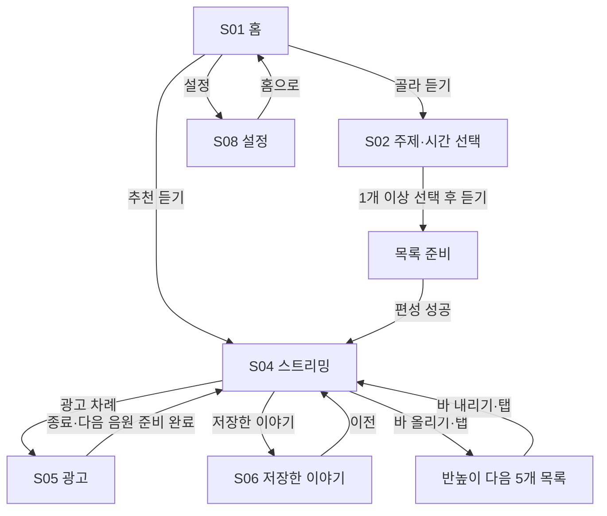

> 2026-11-05 latest: GET /api/v1/playlist is connected to the recommendation core (default recommend; optional pick/legacy). Blank interests read saved preferences. Existing listening reactions are connected; selection history and skip timing are not. Canonical topics come from PR #10. See [current API contract](../../server/teum/playlist/README.md). Earlier implementation status below is historical.

> S1-11·S1-12 시간·광고·주제 비중의 최신 계약: [추천·편성 구현](S1-11_S1-12_추천_편성_구현.md). 유한 편성 전체를 받아 다음 최대 5개를 표시하며, 광고는 1배속이다. 앱 연동 완료를 의미하지 않는다.

# 온에어 · UI 기능 명세

기준일: 2026-11-04

차량에서 짧은 이야기를 연속 청취하는 서비스 **온에어**의 화면, 사용자 동작, 상태 전환을 정리한다. 서버 요청·응답과 추가 계약은 [API 연동 가이드](api-integration-guide.md)에서 다룬다.

## 1. 범위와 확인 상태

| 구분 | 이 문서에서의 의미 |
| --- | --- |
| Figma 반영 | 화면·선택 표시·대표 전환이 프로토타입에 적용됨 |
| 코드 구현 | PR #2의 main 반영과 PR #4의 브랜치 구현을 구분. 아래 적용 상태 표 참조 |
| 앱 구현 필요 | 실제 미디어 재생, 상태 저장, 서버·차량 SDK 연결이 필요함 |
| 미검증 | 실제 클릭·미디어·네트워크·에뮬레이터·실차 시험 결과로 확인하지 않음 |

Figma 반영은 APK 구현이나 API 연동 완료를 의미하지 않는다. 차량 앱의 실제 연동은 별도 구현 항목이다. 신규 서버 코드는 PR #2로 `server/teum/`에 병합됐으며, 이벤트·토큰·저장 등은 PR #4의 반영을 전제로 한다. 콘텐츠·DB·모델·배포 환경은 별도 준비가 필요하다.

### Figma 바로가기

- [작업 파일](https://www.figma.com/design/9It28NuJJzcmZm9pnc090V)
- [핵심 화면 페이지](https://www.figma.com/design/9It28NuJJzcmZm9pnc090V?node-id=4-37)
- [홈에서 프로토타입 시작](https://www.figma.com/proto/9It28NuJJzcmZm9pnc090V/Teum?node-id=5-42&starting-point-node-id=5%3A42)
- [00 · 핵심 사용 흐름](https://www.figma.com/design/9It28NuJJzcmZm9pnc090V?node-id=14-4545)
- [00 · 화면별 API 연동 안내](https://www.figma.com/design/9It28NuJJzcmZm9pnc090V?node-id=14-4548)
- [00 · 재생·선택·복원 동작](https://www.figma.com/design/9It28NuJJzcmZm9pnc090V?node-id=40-4935)
- [00 · 내비 연동과 제외 조건](https://www.figma.com/design/9It28NuJJzcmZm9pnc090V?node-id=62-6953)

현재 핵심 UI와 00페이지 전달 기준은 **5개 대분류 직접 선택, 수동 15/30/60분, 조건부 목적지 시간, 반높이 목록**이다. 이전 10분·21개 세부 선택·오버레이 방식의 숨겨진 노드는 현재 기능에서 제외한다. Figma의 API 설명은 아래 신규 기준을 설명하며 실제 서버 호출을 수행하지 않는다.

### 서버 연동 기준과 관련 PR

| 기준 | 관련 PR·역할 | 화면 문서에서의 의미 |
| --- | --- | --- |
| 신규 앱 기준 | PR #2 · 서버 모듈 분리 + PR #4 · 토큰·청취·반응 API | #2는 main 병합, #4는 미병합·PR 설명상 미배포. `/api/v1`·신규 이벤트 목표 규격으로 화면을 연결 |
| 콘텐츠 공급 | PR #5 · 대본→TTS→검수→게시, PR #3 · TTS 학습·평가 | 미병합. 앱은 공개된 콘텐츠·음원만 사용하며 실시간 생성 API가 구현됐다고 보지 않음 |
| 기존 시범 | 삭제 전 server_trial 코드 | 구 경로·8종 이벤트 비교용. 신규 화면의 저장·좋아요 취소를 지원하지 않음 |

화면은 서버별로 복제하지 않는다. 아래 화면 동작은 신규 앱의 기준이며 [API 가이드의 신·구 비교](api-integration-guide.md#10-기존-시범-서버와의-차이)에서 구 시범과의 차이를 확인한다. 실제 배포 호스트는 미확정이므로 Figma 시연이 새 서버에 접속 중이라는 뜻은 아니다.

11/4 Slack 피드백에 따라 #4의 잘못된 이벤트·위치/세션·광고 처리와 #5의 관심사 이름·음원 전달은 통합 검증 대기 사항으로 남긴다.

## 2. 화면 지도와 사용 흐름

| ID | 화면 | 주요 역할 | Figma |
| --- | --- | --- | --- |
| S01 | 홈 | 추천 듣기·골라 듣기·설정 진입 | [열기](https://www.figma.com/design/9It28NuJJzcmZm9pnc090V?node-id=5-42) |
| S02 | 골라 듣기 | 대분류와 청취 시간 선택 | [열기](https://www.figma.com/design/9It28NuJJzcmZm9pnc090V?node-id=11-2186) |
| S04 | 스트리밍 | 재생·배속·좋아요·저장·다음 목록 | [열기](https://www.figma.com/design/9It28NuJJzcmZm9pnc090V?node-id=12-2586) |
| S05 | 광고 | 광고 재생과 다음 이야기 연결 | [열기](https://www.figma.com/design/9It28NuJJzcmZm9pnc090V?node-id=12-2676) |
| S06 | 저장한 이야기 | 보관한 콘텐츠 조회·열기·이전 복귀 | [열기](https://www.figma.com/design/9It28NuJJzcmZm9pnc090V?node-id=40-4671) |
| S08 | 설정 | 선택 동의·청취 기록 관리 | [열기](https://www.figma.com/design/9It28NuJJzcmZm9pnc090V?node-id=5-191) |
| S09 계열 | 공통 상태 | 목록 준비·재생 오류·네트워크 오류 | [목록 준비](https://www.figma.com/design/9It28NuJJzcmZm9pnc090V?node-id=40-5404) |

S00·S03·S07은 이번 핵심 흐름의 독립 활성 화면으로 명세하지 않는다. 과거 동의·목록·음성 시안의 번호를 새 기능으로 해석하지 않는다. 플레이리스트는 S04/S05의 펼침 상태로 다룬다.

이 도식의 ‘편성 성공’과 ‘음원 준비 완료’는 앱에서 실제 이벤트로 연결할 조건이다. Figma의 타이머·검토용 키와 구분한다. S06 이전은 기본 S04로 고정 이동하지 않고 실제 진입 화면으로 돌아간다.

## 3. S01 · 홈

**목적:** 설정 없이 바로 듣거나 주제·시간을 정해 듣는 두 경로를 제공한다.

| 요소 | 기능·동작 |
| --- | --- |
| 상단 헤더 | 앱 이름과 설정 진입 제공 |
| 추천 듣기 | 별도 주제·시간 선택 없이 공통 플레이어 진입 |
| 골라 듣기 | S02 진입과 내비 연동 안내 시연 시작 |
| 전체 눌림 상태 | 누르는 동안 해당 블록 전체 배경을 어둡게 표시 |

840×1184 기준 헤더는 높이 96, 두 선택 영역은 각각 840×544다. 추천 영역은 짙은 보라색·흰 글자, 골라 듣기는 밝은 회색·어두운 글자로 구분한다. 원형 아이콘 배경 없이 웨이브폼·슬라이더와 큰 화살표를 사용한다.

추천 듣기의 제품 방향은 수동 정지까지 이어 듣기다. 현재 Figma는 샘플 스트리밍 화면으로 이동하며, 신규 서버에서도 연속 추천·큐 보충은 완성된 기능이 아니다. 필요한 요청과 보충 계약은 [추천·편성 연결](api-integration-guide.md#4-편성추천-연결)을 따른다.

## 4. S02 · 골라 듣기

**목적:** 여러 대분류와 청취 시간을 선택해 편성 요청을 시작한다.

### 선택 가능한 주제

| ID | 대분류 | 화면의 대표 키워드 | 내부 세부 주제 범위 |
| --- | --- | --- | --- |
| A | 사람과 일상 | 직장, 연애, 가족, 인간관계 등 | C01–C05 |
| B | 생활과 취향 | 살림, 음식, 소비, 여행, 건강 등 | C06–C12 |
| C | 지식과 세상 | 과학·AI, 역사, 인문, 사회 등 | C13–C17 |
| D | 문화·취미·이동 | 영화, 음악, 스포츠, 교통 등 | C18–C20 |
| E | 성경과 신앙 | 성경 낭독, 묵상 | C21 |

사용자는 A–E만 선택한다. 세부 21개 선택·더보기·스크롤·별도 편집 오버레이는 노출하지 않는다. P01 사연과 음악은 선택 대상에서 제외한다. 이 분류가 신규 API의 `category` 또는 `/me/interests` 값과 동일하다는 뜻은 아니다. PR #4의 관심사 저장과 PR #5의 제작 콘텐츠 모두 검증된 분류 매핑이 필요하다.

### 버튼과 상태

| 요소·상태 | 동작 |
| --- | --- |
| 이전 | S01로 복귀 |
| 주제 타일 | 복수 선택·재탭 해제. 선택 시 체크·선택 표면 표시 |
| 시간 선택 | 주제 선택을 유지하며 시간과 CTA 문구만 갱신 |
| 수동 시간 | 15분·30분·1시간. 기본 30분 |
| 목적지까지 | 유효한 내비 잔여시간을 받았을 때만 사용. Figma는 24분 예시 |
| 선택 주제 1개 이상 | `선택한 N개 주제 · 선택시간 듣기` CTA 활성 |
| 선택 주제 0개 | `주제를 선택해주세요` CTA 비활성 |
| CTA 실행 | 선택값을 확정하고 목록 준비 상태로 이동 |

현재 프로토타입의 초기 예시는 A/B 선택·30분이다. 최초 사용·재진입 시 앱의 선택 복원 정책은 별도로 확정해야 한다. Figma의 초기 선택을 모든 사용자에게 저장된 선호로 취급하지 않는다.

### 내비 연동 안내

1. S01의 골라 듣기를 누르면 바로 S02로 이동한다.
2. 하단 안내가 올라와 연동 중 상태를 보여 준다.
3. 연동 중에도 주제와 수동 15/30/60분을 바꾸거나 현재 선택으로 듣기를 시작할 수 있다. 목적지 시간만 비활성이다.
4. 성공하면 현재 주제를 유지하고 유효 ETA를 자동 선택한다. 성공 안내는 아래로 숨겨진다.
5. 성공 후에도 수동 시간으로 변경할 수 있다.

실패·목적지 없음은 사용자가 선택한 수동 시간을 유지한다. 수동 조작이 없으면 30분이다. 실제 SDK 연동을 구현·검증하지 못하면 **목적지 옵션과 연동 팝업을 함께 제외하고 수동 시간만 제공**한다. [내비·차량 연동 조건](api-integration-guide.md#8-내비차량-sdk-연동)을 따른다.

### 레이아웃과 구현 경계

- 이전 버튼: 90×90, 아이콘 40. S06도 같은 원본 컴포넌트 사용.
- 타일: 760×102, 세로 간격 15. 시간 버튼: 178×84.
- CTA: 760×108, y=1036, 하단 여백 40.
- 주제·시간 조합의 선택 표시와 0개 비활성은 Figma에 반영되어 있다.
- 실제 편성 전달, 최소 1개 재검증, 요청 중복·취소 처리는 앱 구현 항목이다. 관심사는 신규 `PUT/GET /api/v1/me/interests`로 저장·조회할 수 있으나, A–E 매핑과 편성 쿼리가 비었을 때 저장값을 자동 적용하는 연결은 미완료다.

관련 API: [화면–요청 대응](api-integration-guide.md#2-화면과-api-대응), [대분류 매핑](api-integration-guide.md#5-추가-계약이-필요한-기능).

## 5. S04 · 스트리밍

**목적:** 현재 이야기를 듣고, 다음 큐와 개인 반응을 관리한다.

### 표시 정보와 제어

| 요소 | 기능·동작 |
| --- | --- |
| 홈 | S01로 이동 |
| 저장한 이야기 | S06 진입. 기존 재생 상태는 별도로 유지 |
| 듣기 방식·제목 | 현재 모드와 콘텐츠 제목 표시 |
| 원형 웨이브폼 | 재생 상태 시각화. Figma 파형은 실제 음원 분석 결과가 아님 |
| 진행률·시간 | 현재 콘텐츠의 재생 위치와 전체 길이 표시 |
| 이전 | 이전 콘텐츠 이동. 첫 항목에서는 비활성 |
| 재생·일시정지 | 사용자 재생 의도 변경 |
| 다음 | 다음 콘텐츠 이동. 스킵을 완청으로 기록하지 않음 |
| 배속 | 0.8x / 1.0x / 1.2x / 1.5x 목록을 위로 표시. 선택 후 닫기 |
| 좋아요 | 추천 선호 토글. 저장과 독립 |
| 나중에 듣기 | 보관 토글. S06 목록과 일치해야 함 |

배속은 다음 콘텐츠와 앱 재실행에도 유지할 앱 상태다. Figma에는 대표 배속·재생/정지·좋아요/저장 조합이 연결되어 있으나 실제 미디어 속도와 영속 저장을 실행하지 않는다. 신규 연동에서는 좋아요·해제를 `like/unlike`, 보관·해제를 `save/unsave`로 보내고 `/api/v1/history`의 `liked/saved`와 맞춘다. 재개는 `resume`, 새 콘텐츠 시작은 새 playback_id의 `play`로 구분한다.

좋아요·저장 기본 표면은 `#F1F2F6`, 아이콘은 `#5E6573`이다. 선택하면 **표면 전체 `#6352A0` + 흰 아이콘**으로 표시한다. 얇은 보라색 선택 테두리는 사용하지 않는다. 표면 80×80·아이콘 36·터치 영역 112×96을 유지한다.

주 재생 버튼은 144×120·아이콘 52다. 이전·다음은 112×96 안에서 아이콘 32와 글자 24를 상하로 묶는다. 이 수치는 Figma 작업 단위이며 차량의 물리 터치 크기를 보증하지 않는다.

### 하단 플레이리스트

[펼침 화면 보기](https://www.figma.com/design/9It28NuJJzcmZm9pnc090V?node-id=47-14571)

| 항목 | 접힘 | 펼침 |
| --- | --- | --- |
| 패널 위치·크기 | x0 / y896 / 840×288 | x0 / y600 / 840×584 |
| 목록 표시 | 다음 2개 | 다음 5개 전체 |
| 카드 | 760×84, 간격 12 | 동일 크기·글자·번호 위치 유지 |
| 목록 영역 | x40 / y80 / 760×180 | x40 / y80 / 760×468 |
| 상단 | 현재 플레이어 | 헤더·파형·이야기 제목 유지 |
| 제어 영역 | 재생 제어 노출 | 진행률·재생 제어는 패널에 가려짐 |

패널을 올리거나 바를 누르면 제목 아래까지 펼쳐진다. 이야기 제목 하단은 y584, 패널 시작은 y600으로 간격 16을 둔다. 바를 내리거나 다시 누르면 이전 스트리밍 상태로 돌아간다. 내부 스크롤이나 카드 확대는 사용하지 않는다.

Figma는 방향 구분 없는 `ON_DRAG`와 바의 클릭, Smart Animate 0.3초로 시연한다. 앱은 위/아래 방향·임계값·손가락 추적·스냅을 구현해야 한다. 배속 목록에서 진입한 경우 목록을 닫은 스트리밍 상태로 복귀하는 기존 정책을 따른다.

목록의 제목은 샘플이다. 앱은 현재 항목 다음의 실제 `queue`를 표시하며, 남은 항목이 5개보다 적으면 실제 개수만 보여 준다. 추천 듣기의 보충 계약과 골라 듣기의 종료 경계는 [편성·추천 연결](api-integration-guide.md#4-편성추천-연결)에서 정의한다.

### 골라 듣기와의 연결

현재 Figma는 S02 완료 후 공통 로딩을 거쳐 기존 추천 플레이어를 공유한다. 선택한 대분류·시간에 따라 실제 다른 큐가 생성되거나 모드 문구가 동적으로 바뀌는 구현은 아니다. 앱에서는 요청 당시 확정한 선택값과 편성 응답을 기준으로 골라 듣기 모드·목록을 표시해야 한다.

관련 API: [콘텐츠·음원](api-integration-guide.md#3-신규-api-계약), [청취 이벤트·복원](api-integration-guide.md#6-앱-상태와-이벤트-처리).

## 6. S05 · 광고

**목적:** 큐에 포함된 광고를 구분해 재생하고 다음 이야기로 연결한다.

| 요소·상황 | 동작 |
| --- | --- |
| 광고 표시 | 일반 이야기와 구별되는 `광고` 문구 유지 |
| 이전·다음 | 비활성. 광고를 일반 다음 버튼으로 넘기지 않음 |
| 재생·일시정지 | 사용자 조작과 시스템 인터럽트 유지 |
| 종료 안내 | 광고가 끝나면 다음 이야기가 자동 재생됨을 표시 |
| 하단 목록 | 광고 후 다음 항목 표시. 같은 반높이 패널 사용 |
| 종료·다음 음원 준비 완료 | 사용자 일시정지가 아니고 포커스 정책상 허용될 때 다음 이야기 재생 |
| 다음 음원 준비 지연 | `다음 이야기를 준비하고 있어요` 표시 |

광고에는 좋아요·보관 제어를 추가하지 않는다. 광고 안내는 중앙 정렬한다. 사용자 일시정지는 준비 완료나 네트워크 복구만으로 해제하지 않는다. 임의의 5초 대기를 두지 않는다.

광고는 서버 응답의 `kind=ad` 순서를 따른다. 앱에서 광고를 다시 삽입하지 않는다. 신규 `ad_start/ad_complete/ad_error`는 일반 청취 이벤트와 별도로 기록한다. 광고 배속·집계의 제품 정책·연속 편성 시 카운터 유지 등 미확정 사항은 [추가 계약](api-integration-guide.md#5-추가-계약이-필요한-기능)에 정리한다.

## 7. S06 · 저장한 이야기

**목적:** 나중에 듣기로 보관한 콘텐츠를 열고 원래 스트리밍으로 돌아간다.

| 요소 | 기능·동작 |
| --- | --- |
| 이전 버튼 | S02의 `Teum/Pick5/back`과 동일 컴포넌트. x40/y20·90×90·아이콘 40 |
| 이전 동작 | Figma native `BACK`. 홈이 아니라 실제 직전 스트리밍 화면으로 복귀 |
| 저장 카드 | 제목·분류·길이 표시. 현재 시안은 샘플 1개 |
| 카드 선택 | 마지막 위치에서 열기 안내. 현재 연결은 대표 일시정지 플레이어 |
| 저장 해제 | 앱에서는 보관 상태와 목록을 함께 갱신 |

S06 단독 프로토타입 시작은 이전 이력이 없으므로, 스트리밍의 저장한 이야기를 눌러 진입해 복귀를 확인한다. 실제 앱에서는 목록을 열거나 닫아도 현재 콘텐츠·위치·배속·사용자 일시정지·패널 상태를 초기화하지 않는다.

신규 기준은 별도 저장 API 추가가 아니라 `save/unsave` 전송과 `/api/v1/history`의 `saved=true` 필터다. 공개 콘텐츠 조회를 결합해 제목·길이를 표시하고 원래 미디어 위치로 연다. 저장 목록·마지막 위치·빈 목록·공개 철회·보류 중 토글에는 실제 앱 연결이 필요하다. 기존 시범 서버에는 saved 상태가 없으므로 이 동작을 구 API에 기대하지 않는다. [저장 계약](api-integration-guide.md#5-추가-계약이-필요한-기능)을 따른다.

## 8. S08 · 설정

**목적:** 선택 동의와 이 차량의 청취 기록 관리 진입을 제공한다.

| 항목 | 현재 시안·필요 동작 |
| --- | --- |
| 선택 동의 관리 | 개인화 사용 여부와 별도 마케팅 동의 구분 |
| 개인화 미사용 | 기본 추천으로 청취할 수 있다는 안내 |
| 청취 기록 삭제 | 이 차량의 기록 삭제 진입. 실제 삭제 계약과 완료·실패 처리가 필요 |
| 서비스 범위 | 차량·주행 데이터 광고 타기팅 없음, 다운로드·오프라인 청취 미제공이라는 기획 조건. 현재 대표 설정 화면은 동의·삭제 진입 중심 |
| 홈으로 | S01 복귀 |

동의·삭제는 UI와 과거 참고 분기가 있으며 현재 API의 완료 기능이 아니다. 동의 목적·항목·보관기간·철회, 로컬/서버 삭제 범위를 확정해야 한다. 기능 제한 중에는 설정·동의·구성 편집을 차단한다.

## 9. 공통 상태와 복원

| 상태 | 표시·동작 | Figma |
| --- | --- | --- |
| 목록 준비 | `이야기 목록을 불러오고 있어요`, 80×80 시계 아이콘, 취소·홈 | [열기](https://www.figma.com/design/9It28NuJJzcmZm9pnc090V?node-id=40-5404) |
| 음원 오류 | 현재 콘텐츠·위치 유지, 다시 시도·다음 이야기 | [열기](https://www.figma.com/design/9It28NuJJzcmZm9pnc090V?node-id=40-5412) |
| 네트워크 오류 | 연결 확인 안내, 다시 시도·홈 | [열기](https://www.figma.com/design/9It28NuJJzcmZm9pnc090V?node-id=40-5420) |
| 광고 후 준비 | 다음 음원 준비 완료를 기다림 | [열기](https://www.figma.com/design/9It28NuJJzcmZm9pnc090V?node-id=54-15883) |
| 구성 편집 제한 | 편집 차단, 기존 선택 유지 | [열기](https://www.figma.com/design/9It28NuJJzcmZm9pnc090V?node-id=61-596) |

현재 Figma 목록 준비는 **1.2초 후 S04로 자동 이동하는 성공 시연**이다. Enter 성공·E 음원 오류·N 네트워크 오류도 검토용 키다. 앱에서는 실제 편성 성공 후 이동하고, 취소한 요청의 늦은 응답으로 재생을 시작하지 않는다.

오류 재시도는 같은 요청 또는 콘텐츠·위치를 유지한다. Figma의 재시도 성공/실패 검토 분기는 실제 네트워크 결과가 아니다. 앱은 실제 성공 후 원래 상태로 돌아가고 재실패하면 오류를 유지한다.

앱 재실행은 마지막 콘텐츠·위치·배속을 복원하되 **일시정지로 열고 직접 재개**한다. 내비 안내 전 재생 중이었으며 포커스 정책이 허용할 때만 안내 후 복원한다. 사용자 일시정지·영구 포커스 상실·시동 종료는 자동 재생하지 않는다.

## 10. 공통 디자인·차량 적용

| 역할 | 현재 값 |
| --- | --- |
| 플레이어 Primary | `#6352A0` |
| 보조 강조 표면 | `#F4F1FA` |
| 기본 / 목록 패널 | `#FFFFFF` / `#F8F8FC` |
| 보조 버튼 / 아이콘 | `#F1F2F6` / `#5E6573` |
| 주요 글자 / 보조 글자 | `#1E222B` / `#687082` |
| 진행 전 Track / 카드 경계 | `#ECEAF3` / `#EAEBEE` |

S01/S02는 진입 화면의 별도 보라색 `#52389E` 규격을 사용한다. 앱에서는 역할별 토큰으로 관리한다.

840×1184는 대표 Figma 창이다. 실제 차량 density·fontScale·insets·물리 터치 크기를 확인해 반응형으로 적용한다. 주행 제한은 화면 개수나 타일 수로 판단하지 않고 실제 `CarUxRestrictions`에 따른다. 제한 상태가 미수신이면 편집을 잠그는 설계를 적용하고 모든 진입 경로에서 검사한다.

반복 파형은 정차·재생 중에만 허용하는 참고 모션이다. 주행 중·일시정지·대기 아이콘은 정적으로 표시한다. 실제 음원·차량 정책은 [API 연동 가이드](api-integration-guide.md#8-내비차량-sdk-연동)를 따른다.

## 11. 확인 항목

- [ ] S01 두 진입·눌림 상태·설정 이동을 확인한다.
- [ ] S02 복수 선택·해제·시간 유지·정확한 CTA·0개 비활성을 확인한다.
- [ ] 내비 연동 중 수동 선택·시작, 성공 시 주제 유지·ETA 전환, 실패 대안을 확인한다.
- [ ] 실제 큐와 스트리밍 모드·제목·시간·배속이 일치한다.
- [ ] 좋아요·보관은 독립이며 선택 채움·목록 상태가 일치한다.
- [ ] 반높이 패널에서 제목과 같은 크기의 5개 카드가 보이고 복귀 상태가 유지된다.
- [ ] S06 이전은 진입했던 재생/일시정지·배속·패널 상태로 돌아간다.
- [ ] 광고 이전/다음 비활성·준비 지연·사용자 정지·자동 복귀 조건을 확인한다.
- [ ] 로딩 취소·빈 큐·음원 404·네트워크 실패·재시도·앱 재실행을 확인한다.
- [ ] 실제 주행 제한·오디오 포커스·차량 창 크기에서 검증한다.

신규 이벤트 전송은 10초 주기·배속 포함·같은 event_id 재전송·영속 seq·최대 500개 배치의 v0.21 규칙을 따른다. 완청은 앱이 탐색 위치로 판정하지 않고 서버의 유효 청취 구간 completed를 사용한다. 자세한 필드와 예외는 [신규 API 계약](api-integration-guide.md#3-신규-api-계약)을 따른다.

위 목록은 구현 수용 기준이며 완료된 시험 결과가 아니다. 현재 확인 범위는 Local Bridge의 구조 조회·변경 적용 기록·대표 PNG 검토다.
