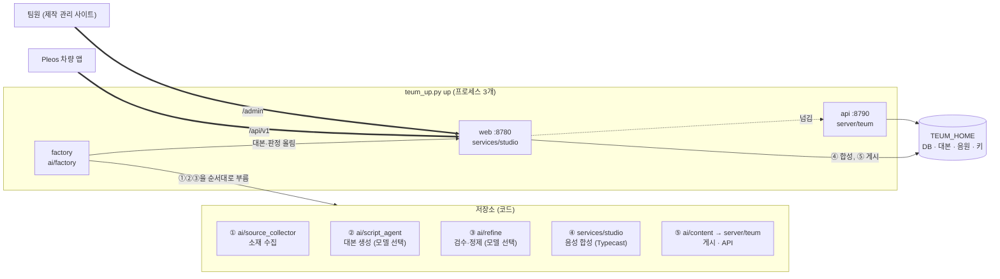

# 서버 한 대에서 온에어 전체 실행

코드는 이 저장소 하나, 바뀌는 데이터는 `TEUM_HOME` 폴더 하나, 실행은 명령 하나로 맞춘다. 소재가 들어오면 대본 생성, 검수, 수정 왕복, 음성 합성까지 자동으로 진행한다. 게시는 사람이 음원을 듣고 정하는 것이 기본이고, `TEUM_AUTO_PUBLISH=1`이면 받아쓰기 대조를 통과한 음원을 사람 없이 게시한다.

## 구조



| 프로세스 | 코드 | 하는 일 |
|---|---|---|
| `api` | `server/teum` | 차량 앱이 붙는 API. 추천·편성, 검색, 청취 기록 |
| `web` | `services/studio` | 제작 관리 사이트(`/admin`), 청취 웹앱(`/app`). `/api/v1`은 `api`로 넘긴다. 검수를 통과한 대본의 목소리 배정, Typecast 합성, 받아쓰기 대조, 게시를 맡는다 |
| `factory` | `ai/factory` | 소재 → 대본 생성 → 사이트 제출 → 검수 → 수정 왕복을 주기적으로 돈다. `TEUM_FACTORY=1`일 때만 움직인다 |

① 수집은 `TEUM_COLLECT_CMD`에 수집 명령을 적으면 켜진다. 루프는 이 명령을 `TEUM_COLLECT_INTERVAL`(기본 하루)마다 한 번 부른다. 비워 두면 사람이 소재 md를 입력함에 넣는다. 연결 방법은 아래 "소재 수집기 연결"에 있다.

`TEUM_HOME` 아래에는 `admin_data/`(사이트 DB, 계정), `scripts_live/`(대본), `work_pipeline/`(제작 상태), `data_root/`(게시된 카탈로그와 음원), `audio_live/`, `voice_img/`, `script_agent/`(생성기 작업 폴더. `input/`이 소재 입력함), `factory/`(자동 제작 기록), `logs/`, 그리고 `teum.env`가 놓인다.

## 설치와 실행

Python 3.11 이상이 필요하다(`ai/script_agent`가 `tomllib`을 쓴다). 음원을 변환하는 `ffmpeg`도 PATH에 있어야 한다. 관리자 권한이 없는 서버에서는 conda 환경에 `python=3.12`와 `ffmpeg`를 같이 설치해 쓰고, 다른 위치의 `ffmpeg`는 `TEUM_FFMPEG`에 경로를 적는다.

```bash
python3.12 -m venv /data/teum/venv
/data/teum/venv/bin/pip install -r infra/one-server/requirements.txt
/data/teum/venv/bin/pip install -e ai/script_agent

export TEUM_HOME=/data/teum/home
/data/teum/venv/bin/python infra/one-server/teum_up.py init     # 폴더, teum.env, 팀원 계정, 빈 카탈로그를 만든다
/data/teum/venv/bin/python infra/one-server/teum_up.py up       # 세 프로세스를 띄우고 죽으면 다시 띄운다
/data/teum/venv/bin/python infra/one-server/teum_up.py status
/data/teum/venv/bin/python infra/one-server/teum_up.py down     # 세 프로세스를 내린다. 설정을 바꾼 뒤에는 down, up 순서로 다시 띄운다
```

## 대본 한 편을 끝까지 보내 보기

대본 파일 하나가 음성, 검수, 카탈로그 등록을 거쳐 서버에서 재생되는 것을 확인하는 순서다. 담당자가 아니어도 이 순서대로 하면 된다. Typecast 키(`TEUM_HOME/typecast.env`의 `TYPECAST_API_KEY`)가 있어야 하고, 합성한 글자 수만큼 Typecast 크레딧이 든다. 검수는 사람이 판정하면 모델 키 없이도 된다.

1. `teum_up.py up`으로 띄우고 `teum_up.py status`에서 `api`, `web`, `factory`가 모두 떠 있는지 본다.
2. 브라우저에서 `http://127.0.0.1:8780/admin`을 연다. 다른 컴퓨터에서는 `ssh -N -L 8780:127.0.0.1:8780 <서버>`를 먼저 띄운다. 접속 비밀번호는 `TEUM_HOME/teum.env`의 `TEUM_PASS`이고, 사이트 로그인은 이름 `운영`과 `TEUM_HOME/admin_data/passwords.txt`에 적힌 비밀번호다.
3. "대본 올리기"로 대본 md 한 편을 올리고 "제출"을 누른다. 시험용으로는 저장소의 `content/scripts/`에 있는 파일을 그대로 쓴다. 새 대본은 같은 양식(제작 정보 표, "2. 낭독 본문")으로 쓴다.
4. 검수 판정을 기다린다. `TEUM_FACTORY=1`이고 검수 키가 있으면 다음 바퀴(기본 10분)에 자동으로 판정이 붙는다. 그렇지 않으면 검수 칸에서 사람이 "통과"를 고른다.
5. 통과한 대본에서 "음성 만들기"를 누른다. 목소리가 배정되고, 합성된 음원을 받아써서 대본과 대조한 결과가 표시된다.
6. 음원을 듣고 "앱에 추가"를 누른다. 이때 카탈로그에 등록된다.
7. `curl http://127.0.0.1:8780/api/v1/contents`의 목록에 그 대본이 있는지 보고, `http://127.0.0.1:8780/app`에서 재생한다. 차량 앱도 같은 주소의 `/api/v1`에서 받는다.

4에서 6까지를 사람 없이 하려면 아래 "자동 제작 켜기"를 따른다.

## 차량 앱 연결

차량 앱은 `web`(기본 8780)의 `/api/v1`에 붙는다. 이 서버 안이나 SSH 터널(`ssh -N -L 8780:127.0.0.1:8780 <서버>`)로 들어온 `/api/v1` 요청은 사이트 로그인 없이 `api`로 넘어가고, 기기 토큰은 `api`가 검사한다. 공개 주소(Cloudflare 터널)로 들어온 요청은 지금처럼 사이트 로그인이 있어야 한다. Tailscale처럼 다른 기계에서 바로 붙게 하려면 `TEUM_WEB_HOST`를 열고 그 대역을 `TEUM_API_OPEN_NETS`(기본 `127.0.0.1/32,::1/128`)에 더한다.

계속 띄워 두려면 `teum.service`를 systemd 사용자 서비스로 등록한다. 설정 값은 `env.example`에 설명이 있고, 실제 값은 `TEUM_HOME/teum.env`(권한 600)에만 둔다.

## 모델과 키

대본 생성과 검수에 쓰는 모델은 `TEUM_HOME/teum.env`에서 단계마다 한 줄로 고른다. 처음 만든 `teum.env`는 저장소 기본값(작성 Gemini, 자체 검토 GPT, 검수 Claude)이고, 키를 넣기 전에는 그 단계가 돌지 않고 `preflight`에 이유가 나온다. 다른 모델로 바꿀 때는 그 단계의 줄만 바꾸고 다시 띄운다.

| 단계 | 줄 | 고를 수 있는 값 | 키를 두는 곳 |
|---|---|---|---|
| ② 대본 작성 | `TEUM_GENERATOR` | `local`, `gemini[:모델]`, `openai[:모델]` | `TEUM_HOME/script_agent.env`의 `GEMINI_API_KEY`, `OPENAI_API_KEY` |
| ② 자체 검토 | `TEUM_REVIEWER` | `local`, `gemini[:모델]`, `openai[:모델]` | 위와 같음 |
| ③ 검수 | `TEUM_REFINE` | `local`, `claude[:claude-haiku-5-5]`, `claude[:claude-sonnet-5-5]` | `REFINE_ANTHROPIC_KEY_FILE`이 가리키는 파일 |
| ④ 음성 합성 | (Typecast 고정) | | `TEUM_HOME/typecast.env`의 `TYPECAST_API_KEY` |

`local`은 시험용이고 `TEUM_LLM_URL`의 OpenAI 호환 모델 서버(vLLM, Ollama)를 부른다. 기본 주소는 `http://127.0.0.1:8000/v1`이고, `TEUM_LLM_MODEL`을 비우면 서버가 내놓는 첫 모델을 쓴다. 모델 서버는 `teum_up.py`가 띄우지 않으므로 따로 떠 있어야 한다. EXAONE 4.5 33B(vLLM)로 생성, 자체 검토, 검수가 끝까지 도는 것을 확인했다. EXAONE 4.5의 라이선스(EXAONE AI Model License 1.2 - NC)는 모델이 만든 글까지 비상업 용도로 제한하므로, 서비스에 내보낼 대본은 상업 이용이 되는 모델로 만든다. 모델마다 필요한 요청 옵션은 `TEUM_LLM_EXTRA`에 JSON으로 적는다(기본값은 EXAONE의 생각 모드를 끄는 옵션).

```bash
# 예: 대본 작성(Gemini)과 자체 검토(GPT)를 켠다
#   1) TEUM_HOME/script_agent.env 에 GEMINI_API_KEY=..., OPENAI_API_KEY=... (chmod 600)
#   2) teum_up.py 를 다시 띄우고 preflight에서 "② 생성"이 "준비됨"인지 본다
```

키나 모델 서버가 없는 단계는 실행하지 않고 이유를 기록한다. 검수 없이 통과시키는 일은 없다. 사이트의 판정 사유에는 어떤 모델이 검수했는지 적힌다.

```bash
PYTHONPATH=ai/factory/src python -m teum_factory preflight        # 단계별 모델, 키, 사이트 연결, 입력함 상태
PYTHONPATH=ai/factory/src python -m teum_factory tick --dry-run   # 무엇을 할지만 본다. 모델을 부르지 않는다
```

## 자동 제작 켜기

1. `preflight`에서 "② 생성"과 "③ 검수"가 "준비됨"인지 확인한다.
2. `TEUM_HOME/teum.env`에서 `TEUM_FACTORY=1`로 바꾸고 다시 띄운다.
3. 소재 md를 `TEUM_HOME/script_agent/input/`에 넣는다. 수집까지 자동으로 하려면 아래 "소재 수집기 연결"을 따른다.
4. 검수를 통과한 대본의 음성까지 자동으로 만들려면 `TEUM_AUTO_VOICE=1`로 바꾼다. 기본은 꺼짐이고, 꺼 두면 사람이 사이트에서 음성 만들기를 누른다. 켤 때는 하루 합성 한도 `TEUM_DAILY_CREDITS`(기본 5,000자)를 같이 정한다.
5. 게시까지 사람 없이 가려면 `TEUM_AUTO_PUBLISH=1`을 더한다. 받아쓰기 대조에서 걸린 음원, 안전 검사(`TEUM_KANANA_URL`)나 LLM 검사를 건너뛴 채 통과한 대본, `TEUM_AUTO_PUBLISH_HOLD_TOPICS`에 적은 분류(기본값은 시사와 생활경제)의 대본, 생성기가 공개 전 검토 대기(`release_status`)로 표시한 대본은 게시하지 않고 사람에게 남긴다.

비용은 한 바퀴에 생성할 편수(`TEUM_FACTORY_MAX_GENERATE`), 검수할 편수(`TEUM_FACTORY_MAX_REFINE`), 한 바퀴의 검수 예산(`REFINE_TOTAL_BUDGET_USD`), 하루 합성 글자 수(`TEUM_DAILY_CREDITS`)로 막는다. 검수 비용의 하루 합계는 `python -m teum_factory status`에 나오고, 하루나 한 달의 지출 상한은 API 키 콘솔에서 건다. 단계별 동작은 [ai/factory/README.md](../../ai/factory/README.md)에 있다.

## 소재 수집기 연결

`ai/source_collector`는 통과한 소재를 자기 폴더(`ai/source_collector/output/<배치>/`)에 쓴다. `teum_factory.run_collector`가 수집기를 부른 뒤 그 배치의 소재 md를 입력함으로 옮긴다. 수집기 코드는 고치지 않는다.

1. 수집기는 자기 폴더의 `.venv`로 돌고, 소재 형식 검사는 `ai/script_agent/.venv`의 `script-agent`를 부른다. 두 환경을 만든다.

   ```bash
   python3.12 -m venv ai/source_collector/.venv && ai/source_collector/.venv/bin/pip install -e ai/source_collector
   python3.12 -m venv ai/script_agent/.venv && ai/script_agent/.venv/bin/pip install -e ai/script_agent
   ```

2. 실제 수집은 로그인된 `agy` CLI를 쓴다([ai/source_collector/README.md](../../ai/source_collector/README.md)). 서버에서 `agy`가 PATH에 있고 로그인되어 있어야 한다.
3. 모델을 부르지 않는 시험 실행으로 연결을 확인한다. 입력함에 소재 두 편이 생기면 된다. 시험 소재는 확인한 뒤 지운다.

   ```bash
   PYTHONPATH=ai/factory/src python -m teum_factory.run_collector --categories C13 --count 2 --mock
   ```

4. `TEUM_HOME/teum.env`에 수집 명령을 적고 다시 띄운다. 뒤의 인자(`--categories`, `--count`, `--model`, `--min-score`)는 수집기로 그대로 간다.

   ```bash
   TEUM_COLLECT_CMD=python -m teum_factory.run_collector --categories C13 --count 3
   ```

뉴스와 시세 소재를 만드는 `ai/issue_collector`는 아직 이 루프에 연결하지 않았다. 지금은 그 수집기가 내보낸 `IC-*.md`를 사람이 입력함에 넣는다.

## 운영 중인 서버에서 옮기기

1. 사이트 DB, 대본, 제작 상태, 카탈로그, 음원 폴더를 `TEUM_HOME` 아래 같은 이름으로 복사한다.
2. 기존 `teum.env`의 `TEUM_PASS`, `TEUM_COOKIE_KEY`를 새 `teum.env`로 옮긴다. 그래야 팀원 로그인이 유지된다. 예전 계정 아이디를 쓰던 서버는 사이트를 내린 상태에서 `python services/studio/admin_users.py rename`을 한 번 돌려 역할 아이디(`ops`, `script`, `review`, `app`, `viewer`)로 바꾼다. 로그인 이름(운영, 대본, 검수, 앱, 열람)과 비밀번호는 그대로다.
3. 기존 서비스 두 개(사이트, API)를 내리고 `teum_up.py up`을 띄운다. 포트가 같아 터널 설정은 그대로 둔다.
4. `status`와 사이트 화면으로 확인한다. 문제가 있으면 `teum_up.py`를 내리고 기존 서비스를 다시 올린다. 기존 폴더는 건드리지 않았으므로 그대로 돌아간다.

## 테스트

```bash
python -m pytest infra/one-server/tests -q   # 세 프로세스를 임시 폴더에 띄워 차량 앱처럼 부른다 (1분쯤)
```
