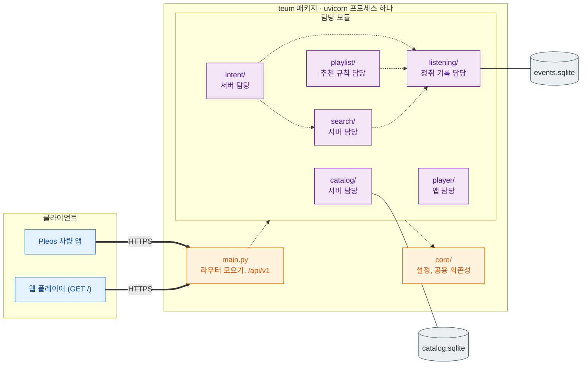

> 2026-11-05: GET /api/v1/playlist now calls the [recommendation core](teum/playlist/README.md) by default. Existing query/response fields remain compatible; mode=legacy selects the old ordering. Blank interests use stored preferences. PR #10 supplies canonical topic definitions. Selection-history and skip-timing storage integrations remain pending.

# 온에어 API 서버

차량 앱(Pleos)이 붙을 백엔드 API다. 담당자마다 패키지 하나를 맡도록 모듈을 나눴다. 서버 프로세스는 하나로 띄운다. 기능과 응답은 이전 시범 서버와 같고, 경로 앞에 `/api/v1`이 붙는다.

콘텐츠 대본·음원과 카탈로그 DB는 저장소에 없다. 테스트는 작은 가짜 카탈로그를 만들어 쓰므로 데이터 없이 돈다.

## 구조



굵은 화살표는 네트워크 요청이다. 점선은 같은 프로세스 안의 함수 호출이고, 실선은 DB 읽기·쓰기다.

모듈끼리는 상대 모듈의 공개 클래스만 부른다. `Catalog`, `SearchIndex`, `ListeningStore`가 그 클래스다. 서버가 뜰 때 `main.py`의 lifespan이 이 셋을 만들어 `app.state`에 올리고, 라우터는 `core/deps.py`의 의존성으로 받아 쓴다. 그래서 청취 기록 DB를 Postgres로 바꿔도 `listening/store.py`만 고치면 된다.

## 담당과 API

| 모듈 | 담당 | API | 안의 파일 |
|---|---|---|---|
| `catalog/` | 서버 담당 (S1-03) | `GET /contents`, `GET /contents/{id}`, `GET /audio·/ads·/gen/{name}` | `service.py` 공개 콘텐츠 로드, `router.py` |
| `search/` | 서버 담당 (S2-08) | `GET /contents/search` | `index.py` BM25·dense·hybrid(RRF), `router.py` |
| `intent/` | 서버 담당 (S3-04) | `POST /intent` | `rules.py` 문장 → 의도, `resolver.py` 의도 → 동작, `router.py` |
| `playlist/` | 추천 규칙 담당 (S1-11, S1-12) | `GET /playlist` | `scheduler.py` 임시 편성 규칙, `router.py` |
| `listening/` | 청취 기록 담당 (S1-02) | `POST /devices`, `POST /events`, `POST /events/batch`, `GET /history`, `PUT·GET /me/interests` | `store.py` 저장소(테이블 5, 저장 트랜잭션에서 상태 재계산), `state.py` 이벤트 → 청취 상태(순수 함수), `schemas.py`, `router.py`. 규격은 `teum/listening/README.md` |
| `player/` | 앱 담당 (Pleos 앱) | `GET /` | 시연용 웹 플레이어 |

API 문서는 서버를 띄운 뒤 `/api/v1/docs`에서 본다.

## 폴더

```
server/
├── teum/
│   ├── main.py          create_app(): lifespan, 라우터 등록
│   ├── core/            config.py(Settings), deps.py(공용 의존성), text.py(글자 정규화, 분류 이름)
│   ├── catalog/  search/  intent/  playlist/  listening/  player/
└── tests/
    ├── conftest.py      가짜 카탈로그(5편, 보류 1편 포함)와 TestClient
    └── test_<모듈>.py   모듈마다 하나
```

## 실행과 테스트

```bash
cd server
uvicorn teum.main:app --port 8765      # 카탈로그가 있는 서버에서
python -m pytest -q tests              # 어디서나
```

| 환경변수 | 기본값 | 뜻 |
|---|---|---|
| `TEUM_DATA_ROOT` | 시범 운용 실행 폴더 | `outputs/catalog.sqlite`, `outputs/index/`, `inputs/demo_snapshot/`가 있는 폴더 |
| `TEUM_EVENTS_DB` | `runtime/teum_e2e/events.sqlite` | 청취 기록 DB |
| `TEUM_CHANNEL` | `internal_demo` | `public`이면 공개 채널 콘텐츠만 올린다 |
| `TEUM_DENSE` | `1` | `0`이면 임베딩 검색을 끄고 BM25만 쓴다 |

## 설계 근거

| 결정 | 참고한 코드·문서 |
|---|---|
| 도메인별 `APIRouter`, `main.py`에서 모으기 | FastAPI 문서 [Bigger Applications](https://fastapi.tiangolo.com/tutorial/bigger-applications/), [full-stack-fastapi-template](https://github.com/fastapi/full-stack-fastapi-template) `backend/app/api/main.py`, `backend/app/api/routes/` |
| 경로 앞 `/api/v1` | 같은 템플릿 `backend/app/core/config.py`의 `API_V1_STR`, `backend/app/main.py`. 차량 앱은 배포 뒤 업데이트가 느려서 처음부터 버전을 붙인다 |
| 설정을 `Settings` 한 곳에 | 같은 템플릿 `backend/app/core/config.py`, FastAPI 문서 [Settings](https://fastapi.tiangolo.com/advanced/settings/). 서버 venv에 pydantic-settings가 없어 `BaseModel` + `from_env()`로 같은 모양을 만들었다 |
| 시작 시 로드를 import 시점에서 lifespan으로 | FastAPI 문서 [Lifespan Events](https://fastapi.tiangolo.com/advanced/events/). 테스트가 `create_app(settings)`로 임시 경로를 넣을 수 있다 |
| `Annotated[..., Depends()]` 공용 의존성 | 같은 템플릿 `backend/app/api/deps.py` (`SessionDep`, `CurrentUser`) |
| 테스트마다 임시 DB와 앱 | FastAPI 문서 [Testing](https://fastapi.tiangolo.com/tutorial/testing/), 같은 템플릿 `backend/tests/conftest.py`의 `client` fixture. 템플릿은 실제 Postgres가 필요해서 그 부분은 따르지 않았다 |

## listening 모듈

처음 제안했던 6항목은 다음처럼 정리됐다. 규격 전체는 `teum/listening/README.md`.

- `event_id`(UUID) 멱등, `client_ts`·`received_at` 분리, `POST /events/batch`(최대 500) — 채택.
- 이벤트 종류는 시범 서버 8종 유지 + 7종 추가(resume, unlike, save, unsave, ad_start, ad_complete, ad_error). Snowplow 어휘는 쓰지 않는다.
- 사용자 식별은 `POST /devices`가 발급한 토큰(`Authorization: Bearer`). 본문·쿼리의 `user_id`는 무시한다. playlist·search·intent는 당분간 발급받은 `user_id`를 쿼리로 받는다.
- `listen_state(user_id, content_id)`를 이벤트 저장과 같은 트랜잭션에서, 그 사용자·콘텐츠의 이벤트 전체를 seq 순으로 다시 접어 갱신한다. 늦게 온 이벤트도 제자리에 들어간다.
- `like`는 위치와 `last_ts`를 바꾸지 않는다(xfail이던 테스트가 통과 테스트로). 완료(`completed`)는 실제 들은 구간 합 ≥ 80%, 끝 도달(`finished`)은 현재 재생 기준.
- 청취 DB 스키마가 바뀌었다. 기존 `events.sqlite`는 그대로 쓸 수 없으니 `TEUM_EVENTS_DB`를 새 파일로 준다(자동 이관 없음).

## 관심사 분류

카탈로그 `category` 표준은 C01–C21이며 P01은 선택 가능한 관심사가 아니다.
앱·웹 플레이어는 A–E 그룹을 해당 코드 목록으로 펼쳐 `interests`에 보낸다.
서버 폴더에서 `python -m teum.catalog.categories migrate <catalog.sqlite> --dry-run`으로 변경·미매핑 목록을 확인한다.
`--dry-run`을 빼면 이관한다. 광고·기존 코드·미매핑 행은 유지하며 반복 실행해도 추가 변경되지 않는다.
